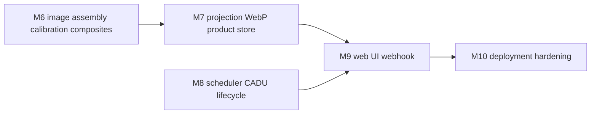

# ElektroDump — Technical Specification for Milestones M6–M10

> Status: design/spec (no code). Source of truth for the M6–M10 workflow.
> Baseline: M1–M5 implemented. C++17, GNU Makefile, POSIX-only, GPLv3, clean-room.
> Build host: WSL Debian (preferred) or MSYS. Flags: `-Wall -Wextra -Wpedantic -Werror`.

This document specifies, per milestone, the exact files, class/function signatures,
config keys, wiring, and acceptance criteria, followed by cross-cutting concerns and a
recommended implementation order. It reuses existing patterns: [`IPipeline`](src/core/pipeline.h:58),
[`Config`](src/core/config.h:12) deep-merge + validation, [`Router`](src/web/router.h:41),
[`fs::atomic_write`](src/util/fs_util.h:22), [`json::Value`](src/util/json_util.h:16), and the
embedded-resource pattern used for [`default_config.inc`](Makefile:142).

---

## 0. Shared conventions and new types

### 0.1 Image buffer representation

All image types live in [`src/image/image.h`](src/image/image.h:1) and are plain PODs with
row-major, channel-interleaved storage (no external image library owns the pixels).

```cpp
// src/image/image.h
namespace ed::image {

struct Image16 {                 // raw or calibrated 16-bit channel data
    int width = 0, height = 0, channels = 1;
    std::vector<uint16_t> data;  // size = width*height*channels
    bool empty() const { return data.empty(); }
    void resize(int w, int h, int c);
};

struct Image8 {                  // 8-bit RGB (3 channels)
    int width = 0, height = 0, channels = 3;
    std::vector<uint8_t> data;
    void resize(int w, int h, int c = 3);
};

struct ImageRGBA {               // 8-bit RGBA (4 bytes/pixel)
    int width = 0, height = 0;
    std::vector<uint8_t> data;
    void resize(int w, int h);
};

struct Mask {                    // per-pixel validity (0 = invalid)
    int width = 0, height = 0;
    std::vector<uint8_t> data;
    void resize(int w, int h);
};

}  // namespace ed::image
```

Rationale: matches PLAN.md D5 exactly, keeps memory accounting explicit (E.4), and lets the
projection/WebP layers operate on raw buffers without a dependency on libpng/libwebp types.

### 0.2 Optional-dependency policy

New optional libraries are detected with `pkg-config` exactly like the existing
`HAVE_RTLSDR`/`HAVE_AIRSPY`/`HAVE_FFTW`/`HAVE_MHD` block in the [`Makefile`](Makefile:33):

| Library | Macro | Used by | Fallback when absent |
|---|---|---|---|
| `libwebp` | `ED_HAVE_WEBP` | M7 WebP writer | write PNG (libpng) or PPM |
| `libpng` | `ED_HAVE_PNG` | M6 LUT/map loading, M7 PNG fallback | built-in grayscale LUT, no map underlay |
| `libcurl` | `ED_HAVE_CURL` | M9 webhook | webhook disabled, logged once |

The build must always succeed with none of them present (mock/file SDR + self-contained FFT
already guarantee this). Every optional path is guarded by `#ifdef ED_HAVE_*` with a working
scalar fallback.

### 0.3 Product builder bridge (M6→M7)

A single new class, [`ProductBuilder`](src/image/product_builder.h:1), is the seam between the
decode path and the image path. It owns the one worker thread (T3, `SCHED_IDLE`) described in
PLAN.md B.2 and is the only place that touches calibration, composites, projection and the
product store. Both the live [`XritPipeline`](src/core/pipeline_xrit.cpp:1) and the offline
`decode`/`image` CLI feed it the same way.

```cpp
// src/image/product_builder.h
namespace ed::image {

class ProductBuilder {
public:
    ProductBuilder();
    ~ProductBuilder();

    // Load calibration, LUTs, projection config and the product store.
    bool configure(const Config& cfg, std::string* error);

    // Called from the decode thread (T2). Non-blocking: enqueues the file.
    void submit(const xrit::XritFile& file);

    // Called when a capture ends so partial channels are flushed.
    void flush();

    void start();   // spawns the worker thread
    void stop();    // joins, flushes

    struct Stats {
        uint64_t channels_assembled = 0;
        uint64_t products_written = 0;
        uint64_t products_failed = 0;
        uint64_t segments_missing = 0;
    };
    Stats stats() const;

    // Set by App: invoked on the worker thread after a product is published.
    using ProductCallback = std::function<void(const output::ProductMeta&)>;
    void set_product_callback(ProductCallback cb);
};

}  // namespace ed::image
```

`submit()` copies the file into a bounded queue (capacity from
`products.queue_depth`, default 64). If the queue is full the file is dropped and
`products_failed` is incremented — the decode thread must never block (PLAN.md E.2).

---

## 1. M6 — Image assembly, calibration, composites

### 1.1 Goal

Turn decoded xRIT files (from [`XritDemux`](src/xrit/xrit_demux.h:26)) into full-disk
`Image16` per channel, calibrate them, and build the `visual`, `ir`, `ir_cloud` (and optional
`ir_cloud_map`) composites.

### 1.2 New files

| File | Responsibility |
|---|---|
| [`src/image/image.h`](src/image/image.h:1) | `Image16`, `Image8`, `ImageRGBA`, `Mask` (see 0.1) |
| [`src/image/image_ops.h`](src/image/image_ops.h:1) / `.cpp` | resize (bilinear), crop, stretch, equalize, downscale |
| [`src/image/image_assembler.h`](src/image/image_assembler.h:1) / `.cpp` | xRIT segments → full-disk `Image16` per channel |
| [`src/image/calibration.h`](src/image/calibration.h:1) / `.cpp` | MSU-GS LUT load + unit conversion |
| [`src/image/lut.h`](src/image/lut.h:1) / `.cpp` | 1D/2D palette sampling (libpng optional) |
| [`src/image/alpha_blend.h`](src/image/alpha_blend.h:1) / `.cpp` | Porter-Duff over + draw_alpha |
| [`src/image/composite.h`](src/image/composite.h:1) / `.cpp` | visual / ir / ir_cloud / ir_cloud_map builders |
| [`src/image/product_builder.h`](src/image/product_builder.h:1) / `.cpp` | worker thread + orchestration (0.3) |
| [`src/cli/cmd_image.cpp`](src/cli/cmd_image.cpp:1) | offline `image <xrit-dir>` command |
| [`resources/calibration/msugs_table.json`](resources/calibration/msugs_table.json:1) | calibration LUT data |
| [`resources/luts/ir_gray.png`](resources/luts/ir_gray.png:1) | 1D IR palette |
| [`resources/luts/ir_cloud.png`](resources/luts/ir_cloud.png:1) | cloud palette |
| [`resources/maps/world_equirect.png`](resources/maps/world_equirect.png:1) | optional underlay |

Note: PLAN.md C lists `image_assembler` under `src/xrit/`; this spec places it under
`src/image/` per the task instruction (it is image-domain logic, not transport).

### 1.3 Image assembler

```cpp
// src/image/image_assembler.h
namespace ed::image {

struct AssembledChannel {
    uint8_t channel_id = 0;
    uint16_t sc_id = 0;
    Image16 image;                 // raw counts, one channel
    Mask valid;                    // 0 where a segment was missing
    int segments_expected = 0;
    int segments_present = 0;
    bool partial = false;          // missing ratio > decode.max_missing_segment_ratio
    xrit::ImageStructureRecord structure;
    xrit::ImageNavigationRecord navigation;
    bool has_navigation = false;
    std::string timestamp_utc;     // from TimeStampRecord, ISO-8601
};

class ImageAssembler {
public:
    explicit ImageAssembler(const Config& cfg);

    // Feed one finalized xRIT file. Returns true when a channel is complete
    // (all planned segments seen) or when flush() is called.
    bool push(const xrit::XritFile& file, AssembledChannel& out);

    // Emit any in-progress channels (called at capture end).
    void flush(std::vector<AssembledChannel>& out);

    void reset();

    struct Stats {
        uint64_t files = 0;
        uint64_t segments_placed = 0;
        uint64_t segments_missing = 0;
        uint64_t channels = 0;
    };
    Stats stats() const;

private:
    const Config* config_ = nullptr;
    // key = (sc_id, channel_id)
    std::map<std::pair<uint16_t, uint8_t>, AssembledChannel> wip_;
    Stats stats_;
};

}  // namespace ed::image
```

**Stitching algorithm** (PLAN.md D3.10, digest §4.3):

1. Only files with `file_type_code == 0` (image) and a
   [`SegmentIdentificationRecord`](src/xrit/xrit_headers.h:154) are considered.
2. Group by `(sc_id, channel_id)`. On the first segment, allocate the full-disk buffer from
   [`ImageStructureRecord`](src/xrit/xrit_headers.h:49): `columns_count` × `lines_count`,
   `bits_per_pixel` (10 or 8).
3. `segment_height = lines_count / (planned_end_segment - planned_start_segment + 1)`
   (integer; if it does not divide evenly, use `ceil` and clamp the last segment). Allow an
   override `image.segment_height` for cases where the header is wrong (open question #1).
4. Row offset = `(segment_sequence_number - planned_start_segment) * segment_height`.
5. Unpack `bits_per_pixel`-wide big-endian samples into `uint16_t` (10-bit → value 0..1023).
6. Mark `valid` rows present; count missing segments. When
   `missing / expected > decode.max_missing_segment_ratio` set `partial = true` but still emit.
7. `flush()` emits every in-progress channel (used at capture end / offline).

### 1.4 Calibration

```cpp
// src/image/calibration.h
namespace ed::image {

enum class CalUnit { Reflectance, BrightnessTemperature, Radiance, Counts };

struct CalibrationTable {
    bool valid = false;
    // lut[channel][raw] -> calibrated value; raw in 0..1023
    std::vector<std::vector<double>> lut;
    std::vector<double> wavelengths_um;   // per channel
    std::vector<CalUnit> units;           // per channel
    std::vector<double> wavenumber_cm1;   // derived: 1e4 / wavelength_um
};

// Load resources/calibration/msugs_table.json. Missing file => valid=false
// (calibration becomes a pass-through, logged once).
CalibrationTable load_calibration(const std::string& path, std::string* error);

// Apply the LUT. Invalid pixels (raw == 0 || raw > 1023) are cleared in out_valid.
Image16 calibrate(const Image16& raw, const Mask& valid,
                  const CalibrationTable& table, int channel_id,
                  Mask* out_valid);

}  // namespace ed::image
```

**Math references** (digest §5.4): channels 0–2 → reflective radiance/reflectance; channels
≥ 3 → emissive radiance / brightness temperature. Wavenumber = `1e4 / wavelength_um`
(`freq_to_wavenumber(c/λ)`). The table JSON schema:

```json
{
  "version": 1,
  "channels": [
    { "id": 0, "wavelength_um": 0.5, "unit": "reflectance", "lut": [ /* 1024 doubles */ ] },
    { "id": 3, "wavelength_um": 10.7, "unit": "brightness_temperature", "lut": [ /* ... */ ] }
  ]
}
```

If `calibration.enabled == false` or the table is missing, `calibrate()` returns the raw
counts unchanged and `valid` is passed through (so composites still render, just uncalibrated).

### 1.5 LUTs and alpha blending

```cpp
// src/image/lut.h
namespace ed::image {

class Lut1D {
public:
    bool load(const std::string& path);          // PNG strip, Nx1
    bool loaded() const;
    void sample(double t, uint8_t rgb[3]) const; // t in 0..1, clamped
};

class Lut2D {
public:
    bool load(const std::string& path);          // PNG grid, NxM
    bool loaded() const;
    void sample(double u, double v, uint8_t rgb[3]) const; // bilinear
};

}  // namespace ed::image
```

```cpp
// src/image/alpha_blend.h
namespace ed::image {

// Porter-Duff "over": a_out = a2 + a1*(1-a2); c_out = (a2*c2 + a1*c1*(1-a2))/a_out
void over(const ImageRGBA& top, const ImageRGBA& bottom, ImageRGBA& out);

// Per-pixel c = fg*a + (1-a)*bg, alpha kept as max (digest §5.3).
void draw_alpha(const ImageRGBA& fg, Image8& bg);

}  // namespace ed::image
```

When `ED_HAVE_PNG` is undefined, `Lut1D::load` builds a built-in grayscale ramp and
`Lut2D::load` returns false (2D products fall back to 1D).

### 1.6 Composites

```cpp
// src/image/composite.h
namespace ed::image {

struct CompositeConfig {
    std::string name;                 // "visual" | "ir" | "ir_cloud" | "ir_cloud_map"
    int r_channel = 0, g_channel = 1, b_channel = 2;
    double r_min = 0.0, r_max = 1.0;
    double g_min = 0.0, g_max = 1.0;
    double b_min = 0.0, b_max = 1.0;
    double gamma = 1.0;
    std::string lut_path;             // optional 1D/2D LUT
    int ir_channel = 3;
    double ir_min_k = 190.0, ir_max_k = 320.0;
    double cloud_threshold_k = 250.0;
    double cloud_softness_k = 10.0;
    std::string map_path;             // ir_cloud_map underlay
};

Image8    build_visual(const std::vector<Image16>& channels, const CompositeConfig&);
Image8    build_ir(const std::vector<Image16>& channels, const CompositeConfig&);
ImageRGBA build_ir_cloud(const std::vector<Image16>& channels, const CompositeConfig&);
Image8    build_ir_cloud_map(const std::vector<Image16>& channels,
                             const CompositeConfig&, const Image8& map);

}  // namespace ed::image
```

- **visual:** per-channel min/max stretch + gamma → RGB (channels from `image.channel_map`).
- **ir:** IR channel through `ir_min_k..ir_max_k` stretch then a 1D LUT → RGB.
- **ir_cloud:** `alpha = clamp((T_threshold - T) / T_softness, 0, 1)`; colour from the cloud
  LUT; background alpha = 0 (colder cloud tops → more opaque).
- **ir_cloud_map:** Porter-Duff `over` of the cloud RGBA onto the equirectangular map.

**Memory discipline** (PLAN.md D5, E.4): process one channel at a time; downscale to
`products.max_output_dimension` *before* building the composite; never hold more than one
full-resolution channel plus one composite.

### 1.7 Config keys (M6)

| Key | Type | Default | Validation |
|---|---|---|---|
| `calibration.enabled` | bool | `true` | — |
| `calibration.table` | string | `resources/calibration/msugs_table.json` | warn if missing |
| `image.channel_map` | object | `{"vis_r":0,"vis_g":1,"vis_b":2,"ir":3}` | ints 0..15 |
| `image.segment_height` | int | `0` | 0 = derive from header; else 1..4096 |
| `image.max_missing_segment_ratio` | double | `0.05` | 0..1 (mirrors `decode.*`) |
| `products.visual.r_min/r_max/g_min/g_max/b_min/b_max` | double | `0.0`/`1.0` | min < max |
| `products.ir.min_k` / `products.ir.max_k` | double | `190.0` / `320.0` | min < max |
| `products.ir_cloud.map` | string | `resources/maps/world_equirect.png` | warn if missing |
| `products.ir_cloud.map_enabled` | bool | `false` | — |
| `products.queue_depth` | int | `64` | 1..4096 |

Existing keys reused: `products.max_output_dimension`, `products.visual.*`,
`products.ir.channel`, `products.ir.lut`, `products.ir_cloud.*`, `decode.max_missing_segment_ratio`.

### 1.8 Wiring

- [`XritPipeline`](src/core/pipeline_xrit.h:23) gains an optional
  `image::ProductBuilder* products_` set via a new `PipelineIo` field
  `image::ProductBuilder* products = nullptr;` (added to [`PipelineIo`](src/core/pipeline.h:51)).
  In `write_file()` (or right after), call `products_->submit(file)`.
- [`App`](src/core/app.h:27) owns the `ProductBuilder`, configures it in `run_loop()`, starts
  it before the pipeline, and stops it after. It also sets the product callback that (M7)
  publishes to the store and (M9) fires the webhook.
- Offline: new CLI `elektrodump image <xrit-dir>` in
  [`src/cli/cmd_image.cpp`](src/cli/cmd_image.cpp:1) reads `*.lrit` files, feeds an
  `ImageAssembler` + `ProductBuilder`, and writes products. Registered in
  [`src/cli/cli.cpp`](src/cli/cli.cpp:109) and declared in [`cli.h`](src/cli/cli.h:29).

### 1.9 Acceptance criteria (M6)

- A fixture set of xRIT segments assembles into a full-disk `Image16` with the expected
  `columns_count` × `lines_count`; missing segments are reflected in `Mask` and `partial`.
- `visual`, `ir`, `ir_cloud` composites are produced from a fixture; the visual composite
  shows a recognisable Earth disk.
- `ir_cloud` alpha is 0 outside clouds and 255 in cold cloud tops (unit test asserts both).
- `ir` output is monotonic in brightness temperature.
- Peak RSS during composite < 250 MB (measured in the smoke test via `/proc/self/status`).
- `elektrodump image <dir>` produces the same products as the live path.

---

## 2. M7 — Projection, WebP, product store

### 2.1 Goal

Reproject full-disk products to Web Mercator (and optionally equirectangular), encode WebP
at ~85% quality, and persist them in a predictable, atomically-written product store with a
`latest` index and REST enumeration.

### 2.2 New files

| File | Responsibility |
|---|---|
| [`src/projection/projection.h`](src/projection/projection.h:1) | `GeoTransform`, `Projector` interface |
| [`src/projection/webmercator.h`](src/projection/webmercator.h:1) / `.cpp` | Web Mercator fwd/inv |
| [`src/projection/geos.h`](src/projection/geos.h:1) / `.cpp` | geostationary fwd/inv |
| [`src/projection/equirect.h`](src/projection/equirect.h:1) / `.cpp` | equirectangular fwd/inv |
| [`src/projection/reproject.h`](src/projection/reproject.h:1) / `.cpp` | inverse-map + bilinear resample |
| [`src/output/webp_writer.h`](src/output/webp_writer.h:1) / `.cpp` | WebP/PNG/PPM encode |
| [`src/output/product_store.h`](src/output/product_store.h:1) / `.cpp` | save/list/latest/prune + index |
| [`src/output/metadata.h`](src/output/metadata.h:1) / `.cpp` | product JSON sidecar |
| [`src/web/api_products.cpp`](src/web/api_products.cpp:1) | `/api/v1/products*` endpoints |

### 2.3 Projection

```cpp
// src/projection/projection.h
namespace ed::projection {

struct GeoTransform {
    double lon0_deg = 76.0;        // sub-satellite longitude
    double altitude_m = 35786023.0;
    bool sweep_x = false;          // Elektro MSU-GS: false
    double column_scalar = 0.0;    // derived from the navigation record
    double line_scalar = 0.0;
    double column_offset = 0.0;
    double line_offset = 0.0;
    int src_width = 0, src_height = 0;
};

// Derive a GeoTransform from an xRIT ImageNavigationRecord + image size.
GeoTransform geotransform_from_navigation(const xrit::ImageNavigationRecord& nav,
                                          int width, int height,
                                          double subsatellite_lon_deg);

class Projector {
public:
    Image8    reproject_mercator(const Image8& src, const GeoTransform& gt,
                                 int out_w, int out_h) const;
    ImageRGBA reproject_mercator_rgba(const ImageRGBA& src, const GeoTransform& gt,
                                      int out_w, int out_h) const;
    Image8    reproject_equirect(const Image8& src, const GeoTransform& gt,
                                 int out_w, int out_h) const;
};

}  // namespace ed::projection
```

**Math** (digest §6.2, PLAN.md D6):

- Web Mercator fwd: `x = k0*λ`, `y = k0*asinh(tan φ)`; inv: `φ = atan(sinh(y/k0))`, `λ = x/k0`.
- Geostationary fwd/inv: standard GOES/EUMETSAT formulas with `h = 35786023.0`,
  `r_eq = 6378137.0`, `r_pol = 6356752.31414`, `lon0` from the navigation record.
- `column_scalar`/`line_scalar` derived from `column_scaling_factor`, `line_scaling_factor`,
  `column_offset`, `line_offset` and the image dimensions. The reference constant
  `624597.0334223134 * k` is a sanity check, not hard-coded.
- Resampling: bilinear for colour, nearest-neighbour for the validity mask. Precompute the
  inverse map per output row.

### 2.4 WebP writer

```cpp
// src/output/webp_writer.h
namespace ed::output {

struct WebpOptions { int quality = 85; int method = 4; bool lossless = false; };

// Encode to `path` atomically (tmp + fsync + rename). Returns false on failure.
bool write_webp_rgb (const image::Image8&,    const std::string& path, const WebpOptions&);
bool write_webp_rgba(const image::ImageRGBA&, const std::string& path, const WebpOptions&);

// Fallbacks used when ED_HAVE_WEBP is undefined.
bool write_png_rgb (const image::Image8&,    const std::string& path);
bool write_png_rgba(const image::ImageRGBA&, const std::string& path);
bool write_ppm_rgb (const image::Image8&,    const std::string& path);

}  // namespace ed::output
```

`WebPEncodeRGB`/`WebPEncodeRGBA` with `quality=85`, `method=4`. Atomic publish via
[`fs::atomic_write`](src/util/fs_util.h:22) semantics (tmp + rename).

### 2.5 Product store

```cpp
// src/output/product_store.h
namespace ed::output {

struct ProductMeta {
    std::string id;            // "<UTC>_<product>"
    std::string satellite;     // "elektro-l3"
    std::string product;       // "visual" | "ir" | "ir_cloud" | "ir_cloud_map"
    std::string projection;    // "mercator" | "equirect" | "none"
    int width = 0, height = 0;
    std::string capture_start, capture_end, created;  // ISO-8601 UTC
    bool partial = false;
    bool crc_recovered = false;
    std::string path;          // relative to storage root
    std::string ext;           // "webp" | "png" | "ppm"
};

class ProductStore {
public:
    bool configure(const Config& cfg, std::string* error);

    // Write image bytes + JSON sidecar atomically, then update state/latest.json.
    bool save(const ProductMeta& meta, const std::string& bytes);

    bool list(const std::string& type, const std::string& date, int limit,
              std::vector<ProductMeta>& out) const;
    bool latest(const std::string& product, ProductMeta& out) const;
    bool get(const std::string& id, ProductMeta& out) const;

    // Absolute path of a product image (for the /image endpoint).
    std::string image_path(const ProductMeta& meta) const;

    // Retention: delete products older than storage.retention.products_days,
    // never the latest of each type. Returns the number deleted.
    int prune(int products_days) const;

    const std::string& root() const;

private:
    std::string root_;
    std::string products_dir_;
    std::string state_dir_;
    mutable std::mutex mutex_;   // guards latest.json rewrites
};

}  // namespace ed::output
```

**Layout** (PLAN.md D7):

```
<storage.root>/products/<YYYY>/<MM>/<DD>/<satellite>/<product>/<UTC>_<product>.webp
<storage.root>/products/<YYYY>/<MM>/<DD>/<satellite>/<product>/<UTC>_<product>.json
<storage.root>/state/latest.json
```

- `<UTC>` = `YYYYMMDDTHHMMSSZ`; `<satellite>` = `elektro-l3`/`elektro-l4`;
  `<product>` ∈ `visual|ir|ir_cloud|ir_cloud_map`.
- All writes go to `<path>.tmp` then `rename`; `latest.json` is rewritten atomically on every
  new product. On startup, stale `*.tmp` files are removed.
- `latest.json` maps `product -> ProductMeta` for the newest of each type.

### 2.6 REST endpoints (M7)

Registered by [`register_products_api`](src/web/api_products.cpp:1) from
[`WebServer::start`](src/web/web_server.h:45). `WebContext` gains
`const output::ProductStore* products = nullptr;`.

| Method | Path | Behaviour |
|---|---|---|
| GET | `/api/v1/products` | list; `?type=&date=&limit=`; JSON `{products:[...],total}` |
| GET | `/api/v1/products/latest` | `?product=visual&format=webp`; binary body, `Content-Type: image/webp`, `ETag` = id, `Cache-Control: no-cache`; 404 `{"error":"no_product"}` |
| GET | `/api/v1/products/{id}` | metadata JSON |
| GET | `/api/v1/products/{id}/image` | product image bytes |

`/api/v1/status` gains a populated `latest_products` object (currently an empty object in
[`api_status.cpp`](src/web/api_status.cpp:234)).

### 2.7 Config keys (M7)

| Key | Type | Default | Validation |
|---|---|---|---|
| `projection.type` | string | `mercator` | `mercator`\|`equirect`\|`none` |
| `projection.output_width` | int | `2048` | 1..4096 (already validated) |
| `projection.output_height` | int | `2048` | 1..4096 (already validated) |
| `products.format` | string | `webp` | `webp`\|`png`\|`ppm` |
| `products.webp_quality` | int | `85` | 1..100 (exists) |
| `products.webp_method` | int | `4` | 0..6 (exists) |
| `products.products_days` | int | `30` | ≥ 1 (mirrors `storage.retention.products_days`) |

### 2.8 Acceptance criteria (M7)

- A fixture full-disk image reprojects to a Mercator image with the correct aspect ratio and
  georeferencing metadata.
- WebP q85 files decode in a browser and in `dwebp`; PNG/PPM fallbacks decode too.
- `curl /api/v1/products/latest -o latest.webp` yields a valid WebP.
- Projection of a 2048×2048 output completes in < 3 s on the Pi (`SCHED_IDLE`).
- Killing the process mid-write never leaves a corrupt `.webp` (only `.tmp`, cleaned on start).

---

## 3. M8 — Live scheduler, CADU lifecycle, schedule CLI, REST

### 3.1 Goal

Switch between GGAK (default) and scheduled LRIT/HRIT captures by time of day, manage the
CADU spool lifecycle, run the janitor, and make `elektrodump schedule` a real editor that
persists to the user config.

### 3.2 New files

| File | Responsibility |
|---|---|
| [`src/scheduler/schedule_model.h`](src/scheduler/schedule_model.h:1) / `.cpp` | parse/validate/serialise schedule |
| [`src/scheduler/scheduler.h`](src/scheduler/scheduler.h:1) / `.cpp` | 1 Hz time-of-day transitions (T5) |
| [`src/scheduler/cadu_lifecycle.h`](src/scheduler/cadu_lifecycle.h:1) / `.cpp` | spool create/verify/delete + janitor |
| [`src/web/api_schedule.cpp`](src/web/api_schedule.cpp:1) | `GET`/`PUT /api/v1/schedule` |
| [`src/cli/cmd_schedule.cpp`](src/cli/cmd_schedule.cpp:1) | real list/add/remove/enable/disable |

### 3.3 Schedule model

```cpp
// src/scheduler/schedule_model.h
namespace ed::scheduler {

struct ScheduleEntry {
    std::string name;
    int start_minute_of_day = 0;   // 0..1439, in the schedule timezone
    int end_minute_of_day = 0;
    std::string mode;              // "lrit" | "hrit"
    uint64_t frequency_hz = 0;     // 0 = use frequencies.<mode>_hz
    std::string constellation;     // "bpsk" | "oqpsk" (default from mode)
    double symbol_rate = 0.0;      // 0 = use <mode>.symbol_rate
    uint32_t sample_rate_hz = 0;   // 0 = use <mode>.sample_rate_hz
    int priority = 0;              // higher wins on overlap
};

struct Schedule {
    bool enabled = true;
    std::string timezone = "UTC";
    std::string default_mode = "ggak";
    std::vector<ScheduleEntry> entries;
};

struct FieldError { std::string path; std::string message; };

Schedule parse_schedule(const json::Value& root, std::vector<FieldError>* errors);
json::Value schedule_to_json(const Schedule& s);
bool validate_schedule(const Schedule& s, std::vector<FieldError>* errors);

}  // namespace ed::scheduler
```

`parse_schedule` accepts the existing `HH:MM` string form (via
[`time::parse_hhmm`](src/core/time_util.h:1)) and converts to minutes-of-day. Validation
mirrors the rules already in [`Config::validate`](src/core/config.cpp:209): non-empty unique
names, `start != end`, `mode ∈ {lrit,hrit}`; plus `priority` integer and optional
frequency/symbol-rate overrides ≥ 0.

### 3.4 Scheduler

```cpp
// src/scheduler/scheduler.h
namespace ed::scheduler {

struct ScheduleState {
    bool enabled = true;
    std::string active_entry;        // "" when none
    std::string next_entry;
    std::string next_transition_utc; // ISO-8601
    int64_t seconds_to_next = 0;
};

class Scheduler {
public:
    // Called on the scheduler thread when the active mode must change.
    // `entry` is null when falling back to default_mode.
    using TransitionFn = std::function<void(PipelineMode, const ScheduleEntry*)>;

    bool configure(const Config& cfg, std::string* error);
    void set_transition(TransitionFn fn);

    void start();   // spawns the 1 Hz thread (T5)
    void stop();

    ScheduleState state() const;

    // Replace the schedule (from CLI or PUT /api/v1/schedule).
    bool apply(const Schedule& s, std::vector<FieldError>* errors);

    const Schedule& schedule() const;

    // Janitor hook: called every 60 s on the scheduler thread.
    using JanitorFn = std::function<void()>;
    void set_janitor(JanitorFn fn);
};

}  // namespace ed::scheduler
```

**Loop (T5, 1 Hz)** — PLAN.md D4:

1. Compute `now` in the configured timezone.
2. Find the active entry (highest priority on overlap); if none, use `default_mode`.
3. If the active mode differs from the running pipeline, call `TransitionFn`.
4. Publish `ScheduleState` for the web UI.
5. Every 60 s call `JanitorFn`.

**Coordination with App's single-active-pipeline design:** `App` owns the `Scheduler` and
provides the `TransitionFn` that performs the swap on the scheduler thread:

```cpp
// App::switch_mode (new private method)
void App::switch_mode(PipelineMode mode, const scheduler::ScheduleEntry* entry) {
    if (pipeline_) { pipeline_->stop(); pipeline_.reset(); }
    if (sdr_) {
        const uint64_t freq = entry && entry->frequency_hz
            ? entry->frequency_hz
            : config_.get_int(mode == PipelineMode::GGAK ? "frequencies.ggak_hz"
                             : mode == PipelineMode::HRIT ? "frequencies.hrit_hz"
                                                          : "frequencies.lrit_hz", 0);
        sdr_->retune(freq);
    }
    mode_ = mode;
    // construct + configure + attach_io + start the new pipeline (same as run_loop)
}
```

The swap is serialised with the existing `run_loop` startup by a `std::mutex pipeline_mutex_`
in `App`. The SDR is retuned before the new pipeline starts; the old pipeline is fully
stopped (flush CADU, finalize files) first. `WebContext.mode` is updated so `/api/v1/status`
reflects the live mode.

### 3.5 CADU lifecycle

```cpp
// src/scheduler/cadu_lifecycle.h
namespace ed::scheduler {

class CaduLifecycle {
public:
    bool configure(const Config& cfg, std::string* error);

    // Create <storage.root>/spool/xrit/<capture_id>/ and return its path.
    std::string begin_capture(PipelineMode mode, const std::string& capture_id);

    // On success delete the spool; on failure keep it for
    // storage.retention.failed_cadu_hours.
    void end_capture(const std::string& capture_id, bool products_ok);

    // Delete expired failed spools, rotate GGAK CSV, prune products, retry webhooks.
    void janitor();

    struct Stats { uint64_t spools_active = 0; uint64_t spools_deleted = 0;
                   uint64_t spools_retained = 0; };
    Stats stats() const;
};

}  // namespace ed::scheduler
```

State machine (PLAN.md D4): `Spooling → Decoding → Verifying → Deleted|Retained`.
A product is "baked" when the image file exists, is non-zero, decodes, and its sidecar is
written. Never keep IQ.

### 3.6 CLI `schedule` editor

[`src/cli/cmd_schedule.cpp`](src/cli/cmd_schedule.cpp:1) becomes a real editor. It loads the
user config with [`Config::load`](src/core/config.h:23), mutates `schedule.entries`, validates
with `validate_schedule`, and persists with [`Config::save`](src/core/config.h:30) (atomic
write). Surface:

```
elektrodump schedule list
elektrodump schedule add --name <n> --start HH:MM --end HH:MM --mode lrit|hrit
                          [--priority N] [--frequency HZ] [--symbol-rate R]
elektrodump schedule remove <name>
elektrodump schedule enable
elektrodump schedule disable
```

Exit codes: `0` success, `2` usage error, `1` validation failure (field-level messages on
stderr). `list` prints a table and the effective timezone.

### 3.7 REST endpoints (M8)

`register_schedule_api` in [`src/web/api_schedule.cpp`](src/web/api_schedule.cpp:1).
`WebContext` gains `scheduler::Scheduler* scheduler = nullptr;` and
`scheduler::CaduLifecycle* cadu = nullptr;`.

| Method | Path | Behaviour |
|---|---|---|
| GET | `/api/v1/schedule` | current schedule + `ScheduleState` |
| PUT | `/api/v1/schedule` | validate + apply; 200 with applied schedule, or 400 `{"error":"validation_failed","fields":[{"path":...,"message":...}]}` |

`/api/v1/status` `schedule` object is populated from `Scheduler::state()` (replacing the
placeholders in [`api_status.cpp`](src/web/api_status.cpp:211)).

### 3.8 Config keys (M8)

| Key | Type | Default | Validation |
|---|---|---|---|
| `schedule.enabled` | bool | `true` | exists |
| `schedule.timezone` | string | `UTC` | non-empty; warn if not `UTC` |
| `schedule.default_mode` | string | `ggak` | `ggak`\|`lrit`\|`hrit` |
| `schedule.entries[].priority` | int | `0` | integer |
| `schedule.entries[].frequency_hz` | int | `0` | ≥ 0 |
| `schedule.entries[].symbol_rate` | double | `0` | ≥ 0 |
| `schedule.entries[].sample_rate_hz` | int | `0` | ≥ 0 |
| `scheduler.tick_seconds` | int | `1` | 1..60 |
| `scheduler.janitor_seconds` | int | `60` | 10..3600 |
| `storage.retention.failed_cadu_hours` | int | `24` | ≥ 1 (exists) |

### 3.9 Acceptance criteria (M8)

- A schedule entry at `06:00–06:20 UTC` starts within ±2 s and stops within ±2 s.
- After a successful capture the spool directory is gone and products exist.
- After a forced decode failure the spool survives for the retention window.
- `PUT /api/v1/schedule` rejects invalid entries with 400 and a field-level error.
- `elektrodump schedule add/remove/enable/disable` round-trips through the user config and
  `config validate` still passes.

---

## 4. M9 — Full web UI

### 4.1 Goal

Replace the inline fallback dashboard in [`static_files.cpp`](src/web/static_files.cpp:1) with
a multi-page UI (HTML/CSS/JS) served by the same static route, plus the webhook and GGAK API.

### 4.2 New files

| File | Responsibility |
|---|---|
| [`web/index.html`](web/index.html:1) | dashboard: latest image, SNR gauge, lock/BER, time-to-next, sparkline |
| [`web/gallery.html`](web/gallery.html:1) | product grid by date/type; detail + metadata |
| [`web/schedule.html`](web/schedule.html:1) | schedule table editor (PUT /api/v1/schedule) |
| [`web/ggak.html`](web/ggak.html:1) | channel selector, SVG plots, latest values, CSV link |
| [`web/system.html`](web/system.html:1) | CPU, memory, temperature, disk, uptime, SDR, pipeline |
| [`web/waterfall.html`](web/waterfall.html:1) | live FFT spectrum + scrolling waterfall (canvas) |
| [`web/css/app.css`](web/css/app.css:1) | single stylesheet, CSS variables, dark theme |
| [`web/js/api.js`](web/js/api.js:1) | `getJson`, `putJson`, `getBlob` |
| [`web/js/app.js`](web/js/app.js:1) | nav, 1 Hz polling, formatting, error toast |
| [`web/js/dashboard.js`](web/js/dashboard.js:1) | dashboard widgets |
| [`web/js/gallery.js`](web/js/gallery.js:1) | gallery rendering |
| [`web/js/schedule.js`](web/js/schedule.js:1) | schedule editor |
| [`web/js/ggak.js`](web/js/ggak.js:1) | GGAK plots |
| [`web/js/waterfall.js`](web/js/waterfall.js:1) | canvas spectrum + waterfall |
| [`src/web/webhook.h`](src/web/webhook.h:1) / `.cpp` | POST on new product, HMAC, retry/backoff |
| [`src/web/api_ggak.cpp`](src/web/api_ggak.cpp:1) | `/api/v1/ggak*` endpoints |
| [`tools/gen_web_assets.py`](tools/gen_web_assets.py:1) | embed `web/` into `build/gen/web_assets.inc` |

### 4.3 Embed vs serve-from-disk — decision

**Decision: embed the web assets into the binary by default, with a disk override for
development.**

- A Makefile rule runs [`tools/gen_web_assets.py`](tools/gen_web_assets.py:1) over `web/` to
  produce `build/gen/web_assets.inc` containing a `kWebAssets[]` table of
  `{ const char* path; const char* mime; const char* data; size_t size; }`, mirroring the
  existing [`default_config.inc`](Makefile:142) pattern.
- [`static_files.cpp`](src/web/static_files.cpp:1) serves from the table. If
  `web.static_root` exists on disk, it prefers the disk copy (hot reload during development),
  preserving the current behaviour.
- **Justification:** the product is a single-binary appliance (PLAN.md A.1, B.1); embedding
  removes a runtime path dependency, works from any CWD, and matches the embedded-defaults
  precedent. The disk override keeps the dev loop fast. Cost: the binary grows by the size of
  `web/` (tens of KB), which is negligible.

`static_files.cpp` gains a generic route: `GET /<path>` resolves to a known asset (exact
match) or returns 404; `/` and `/index.html` map to `index.html`; extensionless page paths
(`/gallery`, `/schedule`, `/ggak`, `/system`, `/waterfall`) map to the corresponding `.html`.

### 4.4 API surface consumed

| Page | Endpoints |
|---|---|
| dashboard | `/api/v1/status`, `/api/v1/signal`, `/api/v1/products/latest` |
| gallery | `/api/v1/products`, `/api/v1/products/{id}`, `/api/v1/products/{id}/image` |
| schedule | `GET`/`PUT /api/v1/schedule` |
| ggak | `/api/v1/ggak`, `/api/v1/ggak/plots`, `/api/v1/ggak/plots/{channel}.svg` |
| system | `/api/v1/health`, `/api/v1/status` |
| waterfall | `/api/v1/fft` (500 ms, gated by `document.visibilityState`), `/api/v1/waterfall` |

### 4.5 Webhook

```cpp
// src/web/webhook.h
namespace ed::web {

struct WebhookConfig { std::string url; std::string secret; std::vector<std::string> events; };

class WebhookDispatcher {
public:
    bool configure(const Config& cfg, std::string* error);
    void start(); void stop();

    // Enqueue a product.created event (non-blocking; runs on T5).
    void notify_product(const output::ProductMeta& meta, const std::string& base_url);

    // Fire a test event (POST /api/v1/webhook/test).
    bool test(std::string* error);

    struct Stats { uint64_t ok = 0; uint64_t fail = 0; uint64_t queued = 0; };
    Stats stats() const;
};

}  // namespace ed::web
```

- Payload per PLAN.md D9; header `X-ElektroDump-Signature: sha256=<hmac>` when `secret` set.
- Retry 3× with backoff (1 s, 5 s, 25 s), then queue for the janitor. Timeout 5 s. Never
  block the worker thread. Uses libcurl when `ED_HAVE_CURL`; otherwise disabled with a
  one-time warning.

### 4.6 Config keys (M9)

| Key | Type | Default | Validation |
|---|---|---|---|
| `web.static_root` | string | `web` | exists (disk override) |
| `api.webhooks[].url` | string | — | non-empty when present |
| `api.webhooks[].secret` | string | `""` | — |
| `api.webhooks[].events` | array | `["product.created"]` | subset of known events |
| `api.base_url` | string | `""` | used to build absolute URLs in payloads |

### 4.7 Acceptance criteria (M9)

- All pages load in < 1 s on a LAN; dashboard updates at 1 Hz without layout jank.
- Schedule editor round-trips through the API.
- Waterfall runs at ≥ 5 fps on the Pi.
- Webhook fires within 1 s of product creation with a valid HMAC; retries on 500.
- The binary serves the UI with no `web/` directory present (embedded assets).

---

## 5. M10 — Deployment

### 5.1 Goal

Ship a systemd unit and an installer for Raspberry Pi, and wire `make install`/`make deploy-pi`.

### 5.2 New files

| File | Responsibility |
|---|---|
| [`deploy/elektrodump.service`](deploy/elektrodump.service:1) | systemd unit |
| [`deploy/install.sh`](deploy/install.sh:1) | install binary, config, resources, unit |
| [`deploy/elektrodump.tmpfiles`](deploy/elektrodump.tmpfiles:1) | create `/var/lib/elektrodump` |
| [`deploy/README.md`](deploy/README.md:1) | install/upgrade notes |

### 5.3 systemd unit

```ini
[Unit]
Description=ElektroDump ground station
After=network-online.target
Wants=network-online.target

[Service]
Type=simple
User=elektrodump
Group=elektrodump
WorkingDirectory=/opt/elektrodump
ExecStart=/opt/elektrodump/elektrodump run --config /etc/elektrodump/config.json
Restart=always
RestartSec=5
Nice=-5
LimitRTPRIO=50
LimitNOFILE=4096
# Optional: tmpfs spool to spare the SD card (PLAN.md R10)
# Environment=ED_SPOOL_DIR=/run/elektrodump/spool

[Install]
WantedBy=multi-user.target
```

### 5.4 install.sh outline

1. `set -euo pipefail`; require root (or `sudo`).
2. Create the `elektrodump` system user/group if missing.
3. Install the binary to `/opt/elektrodump/elektrodump` (mode 755).
4. Install `resources/` to `/opt/elektrodump/resources/` (calibration, luts, maps).
5. Install `deploy/elektrodump.service` to `/etc/systemd/system/`.
6. Install `deploy/elektrodump.tmpfiles` to `/etc/tmpfiles.d/` and run `systemd-tmpfiles --create`.
7. Seed `/etc/elektrodump/config.json` from `config/config.example.json` if absent.
8. `systemctl daemon-reload && systemctl enable --now elektrodump`.
9. Print the web URL and the log path.

### 5.5 Makefile targets

- `install` (extend): install the binary to `$(DESTDIR)/usr/local/bin`, plus `resources/` and
  `web/` (when not embedded) to `$(DESTDIR)/usr/local/share/elektrodump/`.
- `deploy-pi` (extend): `scp` the binary, `resources/`, and `deploy/` to `$(PI_HOST)`, then
  run `deploy/install.sh` remotely.
- New `deploy-pi-cross`: `make CROSS=aarch64-linux-gnu- PI=1` then `deploy-pi`.

### 5.6 Acceptance criteria (M10)

- `make deploy-pi PI_HOST=pi@elektro.local` installs a working service that survives reboot.
- RSS < 300 MB steady, < 400 MB peak; GGAK CPU < 25% of one core.
- 7-day soak test with no crash and no unbounded growth.
- `systemctl status elektrodump` is healthy after reboot.

---

## 6. Cross-cutting concerns

### 6.1 Complete list of new config keys

| Key | Type | Default | Milestone |
|---|---|---|---|
| `calibration.enabled` | bool | `true` | M6 |
| `calibration.table` | string | `resources/calibration/msugs_table.json` | M6 |
| `image.channel_map` | object | `{"vis_r":0,"vis_g":1,"vis_b":2,"ir":3}` | M6 |
| `image.segment_height` | int | `0` | M6 |
| `image.max_missing_segment_ratio` | double | `0.05` | M6 |
| `products.visual.r_min/r_max/g_min/g_max/b_min/b_max` | double | `0.0`/`1.0` | M6 |
| `products.ir.min_k` / `products.ir.max_k` | double | `190.0` / `320.0` | M6 |
| `products.ir_cloud.map` | string | `resources/maps/world_equirect.png` | M6 |
| `products.ir_cloud.map_enabled` | bool | `false` | M6 |
| `products.queue_depth` | int | `64` | M6 |
| `products.format` | string | `webp` | M7 |
| `products.products_days` | int | `30` | M7 |
| `projection.type` | string | `mercator` | M7 |
| `schedule.entries[].priority` | int | `0` | M8 |
| `schedule.entries[].frequency_hz` | int | `0` | M8 |
| `schedule.entries[].symbol_rate` | double | `0` | M8 |
| `schedule.entries[].sample_rate_hz` | int | `0` | M8 |
| `scheduler.tick_seconds` | int | `1` | M8 |
| `scheduler.janitor_seconds` | int | `60` | M8 |
| `api.base_url` | string | `""` | M9 |
| `frequencies.lo_hz` | int | `0` | M6 (open question #2) |
| `frequencies.ggak_if_hz` / `lrit_if_hz` / `hrit_if_hz` | int | `0` | M6 (open question #2) |

All new keys are added to [`resources/default_config.json`](resources/default_config.json:1)
and validated in [`Config::validate`](src/core/config.cpp:114) following the existing
`err(...)`/`warn(...)` pattern. Unknown keys remain preserved-but-warned (Appendix B).

### 6.2 Makefile changes

1. **Optional deps:** add `libwebp`, `libpng`, `libcurl` detection blocks mirroring the
   existing `HAVE_*` pattern; define `ED_HAVE_WEBP`, `ED_HAVE_PNG`, `ED_HAVE_CURL`; append
   their `--cflags`/`--libs`. Extend the `config` target's `deps` line.
2. **Web asset embedding:** add `WEB_DIR := web`, `WEB_INC := $(GEN_DIR)/web_assets.inc`,
   a rule invoking `python3 tools/gen_web_assets.py $(WEB_DIR) $@`, and make
   `$(OBJ_DIR)/web/static_files.o` depend on `$(WEB_INC)` (same pattern as
   `default_config.o`).
3. **Source discovery:** unchanged — `find $(SRC_DIR) -name '*.cpp'` already picks up the new
   `src/image`, `src/projection`, `src/output`, `src/scheduler` files.
4. **Tests:** `TEST_SRCS := $(wildcard $(TEST_DIR)/*.cpp)` already auto-discovers new
   `tests/*.cpp`; each gets its own binary via the existing pattern rule.
5. **Smoke:** extend the `smoke` target's script list to include `m6_smoke.sh` … `m10_smoke.sh`.
6. **Install/deploy:** extend `install` and `deploy-pi` per 5.5.

### 6.3 New tests

| Test | Covers | Milestone |
|---|---|---|
| [`tests/test_image_assembler.cpp`](tests/test_image_assembler.cpp:1) | segment stitching, missing-segment mask, partial flag | M6 |
| [`tests/test_calibration.cpp`](tests/test_calibration.cpp:1) | LUT load, invalid-pixel handling, unit conversion | M6 |
| [`tests/test_composite.cpp`](tests/test_composite.cpp:1) | visual/ir/ir_cloud, alpha 0 outside clouds | M6 |
| [`tests/test_projection.cpp`](tests/test_projection.cpp:1) | webmerc/geos fwd+inv round-trip, reproject | M7 |
| [`tests/test_webp.cpp`](tests/test_webp.cpp:1) | encode + decode round-trip (or PNG/PPM fallback) | M7 |
| [`tests/test_product_store.cpp`](tests/test_product_store.cpp:1) | save/list/latest/prune, atomic writes | M7 |
| [`tests/test_schedule_model.cpp`](tests/test_schedule_model.cpp:1) | parse/validate/serialise, field errors | M8 |
| [`tests/test_scheduler.cpp`](tests/test_scheduler.cpp:1) | transition selection, priority, next-transition | M8 |
| [`tests/test_cadu_lifecycle.cpp`](tests/test_cadu_lifecycle.cpp:1) | spool create/delete/retain | M8 |

Smoke scripts `tests/m6_smoke.sh` … `tests/m10_smoke.sh` follow the existing
[`m5_smoke.sh`](tests/m5_smoke.sh:1) pattern: build, run a hardware-free fixture through the
CLI/daemon, and assert on outputs and the status API. They are added to the `smoke` target.

### 6.4 Handling PLAN.md open questions

| Open question | Design response |
|---|---|
| #1 image dimensions / channel map | `image.channel_map` + `image.segment_height` override; assembler derives from headers by default |
| #2 LNB/LO frequency | `frequencies.lo_hz` + `frequencies.*_if_hz`; RF = LO ± IF; `probe`/spectrum to find the signal |
| #3 GGAK timestamp offset | already `ggak.time_offset_seconds` (default `-10800`) |
| #4 HRIT availability | schedule entries are explicit; `default_mode` covers gaps |
| #5 IR cloud threshold | `products.ir_cloud.cloud_threshold_k` / `cloud_softness_k` |
| #6 projection output size | `projection.output_width/height` (default 2048) |
| #7 webhook payload | `api.webhooks[].events` + `api.base_url`; schema is a proposal |
| #8 retention defaults | `storage.retention.*` + `products.products_days` |
| #9 multi-satellite | `satellite.id` + `satellite.subsatellite_lon_deg`; schedule entries may carry a satellite in a later phase |
| #10 RDAS/MSU-GS raw path | out of scope; documented as a future extension |

### 6.5 Licensing / clean-room

All new code is original. Calibration tables, LUTs and maps are data files with their own
provenance recorded in [`ATTRIBUTION.md`](ATTRIBUTION.md:1). No GobDump/SatDump source is
copied; algorithms are re-derived from CCSDS/EUMETSAT/Roscosmos specifications. New
third-party libraries (`libwebp` BSD-3, `libpng` libpng license, `libcurl` MIT-like) are
GPLv3-compatible and must be added to the ATTRIBUTION.md table.

---

## 7. Recommended implementation order

Each step is independently verifiable and leaves the tree buildable. M8 is independent of
M6/M7 and may be developed in parallel.



| Order | Step | File set | Verify |
|---|---|---|---|
| 1 | M6a: image types + ops + assembler | `src/image/image.h`, `image_ops.*`, `image_assembler.*`, `tests/test_image_assembler.cpp` | `make test` |
| 2 | M6b: calibration + LUTs | `src/image/calibration.*`, `lut.*`, `resources/calibration/*`, `resources/luts/*`, `tests/test_calibration.cpp` | `make test` |
| 3 | M6c: composites + builder + CLI | `src/image/composite.*`, `alpha_blend.*`, `product_builder.*`, `src/cli/cmd_image.cpp`, `tests/test_composite.cpp`, `tests/m6_smoke.sh` | `make test smoke` |
| 4 | M7a: projection | `src/projection/*`, `tests/test_projection.cpp` | `make test` |
| 5 | M7b: WebP + store | `src/output/*`, `tests/test_webp.cpp`, `tests/test_product_store.cpp` | `make test` |
| 6 | M7c: products API + wiring | `src/web/api_products.cpp`, `WebContext`/`PipelineIo` changes, `tests/m7_smoke.sh` | `make test smoke` |
| 7 | M8a: schedule model + CLI | `src/scheduler/schedule_model.*`, `src/cli/cmd_schedule.cpp`, `tests/test_schedule_model.cpp` | `make test` |
| 8 | M8b: scheduler + lifecycle | `src/scheduler/scheduler.*`, `cadu_lifecycle.*`, `App` wiring, `tests/test_scheduler.cpp`, `tests/test_cadu_lifecycle.cpp` | `make test` |
| 9 | M8c: schedule API | `src/web/api_schedule.cpp`, `tests/m8_smoke.sh` | `make test smoke` |
| 10 | M9a: webhook + ggak API | `src/web/webhook.*`, `src/web/api_ggak.cpp` | `make test` |
| 11 | M9b: web UI + embedding | `web/*`, `tools/gen_web_assets.py`, `src/web/static_files.cpp`, `Makefile`, `tests/m9_smoke.sh` | `make test smoke` |
| 12 | M10: deployment | `deploy/*`, `Makefile` install/deploy, `tests/m10_smoke.sh` | `make deploy-pi` |

---

## 8. Open decisions (genuine product choices)

1. **Channel map for Elektro-L No.3/No.4** — which `channel_id` is VIS-R/G/B vs IR. Default
   `{0,1,2,3}` is a guess; confirm against a real capture or the LRIT/HRIT MSD. Configurable
   via `image.channel_map`.
2. **LNB/LO frequency** — is 1691/1693 MHz the IF or the RF? Add `frequencies.lo_hz` and
   `frequencies.*_if_hz`; decide the default once the dish is known.
3. **Projection output size** — 2048×2048 vs 1024×1024 for Pi speed. Default 2048; revisit
   after profiling.
4. **WebP vs PNG default** — WebP q85 is the plan; confirm all target clients render WebP
   alpha (R7). `products.format` makes it switchable.
5. **Retention defaults** — 30 days of products may be too much for a small SD card; confirm
   `storage.retention.products_days`.
6. **Multi-satellite** — one satellite per install vs schedule-driven No.3/No.4 switching.
7. **Webhook payload fields** — the proposed schema is a starting point; confirm with
   consumers.
