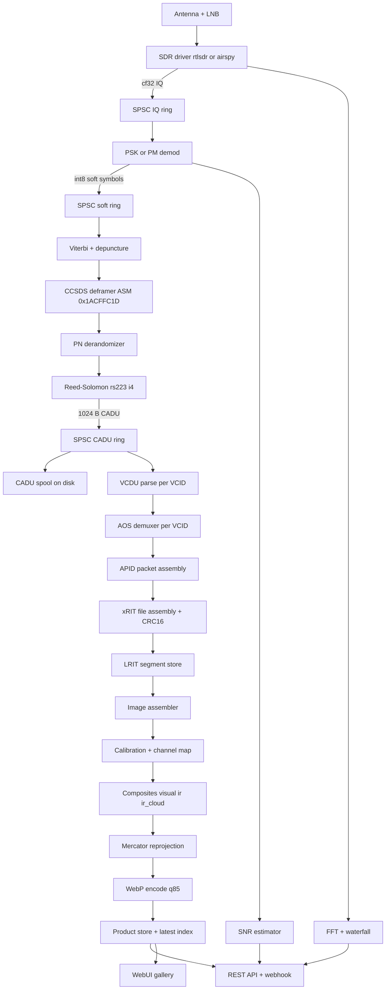
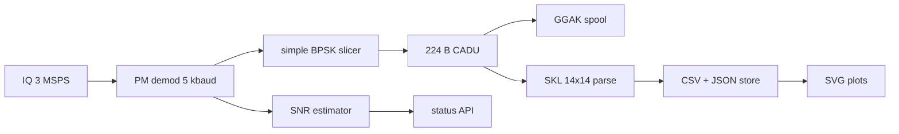
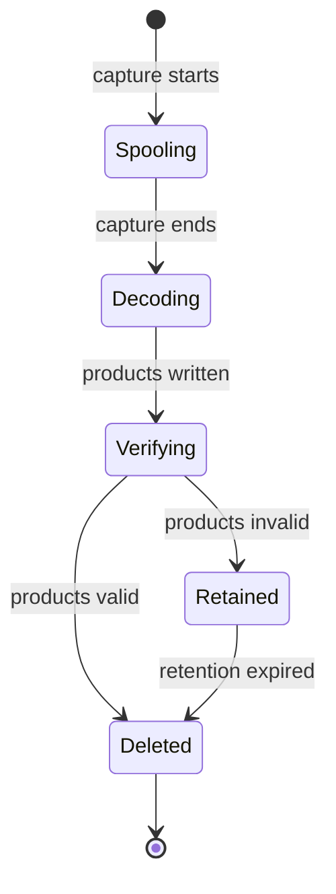

# ElektroDump — Design & Implementation Plan

> **Status:** Design baseline (pre-implementation)
> **Target:** Raspberry Pi 3B+ (Cortex-A53, 1 GB RAM), Debian/Raspbian Lite, headless
> **Build host:** WSL Debian, plain `Makefile`
> **License:** GPLv3
> **Reference:** [`REFERENCE_DIGEST.md`](REFERENCE_DIGEST.md) (methodology source only; no code copied)

---

## Table of Contents

- [A. Overview, Goals, Non-Goals, Principles](#a-overview-goals-non-goals-principles)
- [B. High-Level Architecture](#b-high-level-architecture)
- [C. Project / Directory Structure](#c-project--directory-structure)
- [D. Module-by-Module Design](#d-module-by-module-design)
  - [D1. SDR Abstraction](#d1-sdr-abstraction)
  - [D2. GGAK Pipeline](#d2-ggak-pipeline)
  - [D3. LRIT/HRIT Decode Chain](#d3-lrithrit-decode-chain)
  - [D4. Scheduler & CADU Lifecycle](#d4-scheduler--cadu-lifecycle)
  - [D5. Image Processing & Composites](#d5-image-processing--composites)
  - [D6. Projection & WebP Output](#d6-projection--webp-output)
  - [D7. Storage Layout & Retention](#d7-storage-layout--retention)
  - [D8. WebUI](#d8-webui)
  - [D9. REST API & Webhook](#d9-rest-api--webhook)
  - [D10. Config System](#d10-config-system)
  - [D11. CLI](#d11-cli)
  - [D12. Build System](#d12-build-system)
  - [D13. Logging, Metrics & Health](#d13-logging-metrics--health)
  - [D14. Utilities](#d14-utilities)
- [E. Concurrency & Performance Plan](#e-concurrency--performance-plan)
- [F. Licensing & Attribution](#f-licensing--attribution)
- [G. Phased Implementation Milestones](#g-phased-implementation-milestones)
- [H. Risks & Open Questions](#h-risks--open-questions)
- [Appendix A. Protocol Constants](#appendix-a-protocol-constants)
- [Appendix B. Config Schema](#appendix-b-config-schema)
- [Appendix C. API Schemas](#appendix-c-api-schemas)

---

## A. Overview, Goals, Non-Goals, Principles

### A.1 What ElektroDump is

ElektroDump is a **single-binary, headless, always-on ground station appliance** for the Russian
**Elektro-L No.3 / No.4** geostationary weather satellites. It:

1. Drives an **RTL-SDR or Airspy** receiver at a fixed dish (no tracking — the satellite is GEO).
2. Runs a **GGAK space-weather telemetry pipeline 24/7** at 1693 MHz, emitting CADU frames and
   continuously estimating SNR.
3. On a **user-defined time-of-day schedule**, retunes to **LRIT (1691 MHz, BPSK 294 kbaud)** or
   **HRIT (1691 MHz, OQPSK 1.15 Mbaud)**, captures a full-disk pass, and decodes it to images.
4. Produces **visual, IR, and IR-cloud-with-transparency** composites, reprojects them to
   **Web Mercator**, and writes **WebP at ~85% quality**.
5. Serves a **local web UI + REST API** with live status, FFT/waterfall, gallery, schedule editor,
   GGAK plots, and system health.
6. Fires an **HTTP POST webhook** whenever a new product is baked, and exposes a
   **latest-image endpoint** for external consumers.

### A.2 Goals

| # | Goal | Success criterion |
|---|---|---|
| G1 | 24/7 GGAK reception | CADU emitted continuously; SNR sampled ≥ 1 Hz; no crash over 7 days |
| G2 | Scheduled LRIT/HRIT full-disk capture | Capture starts/stops within ±2 s of schedule; products produced |
| G3 | Correct decode | Viterbi lock + RS-corrected CADU; xRIT files pass CRC-16 |
| G4 | Three product families | `visual`, `ir`, `ir_cloud` (RGBA) written as WebP |
| G5 | Mercator projection | Output is a valid Web Mercator image with correct georeferencing metadata |
| G6 | Clean API | `/api/v1/products/latest` returns a WebP in one request; webhook fires on new product |
| G7 | Pi 3B+ efficiency | Steady-state RSS < 300 MB; GGAK CPU < 25% of one core; capture decode fits in 3 cores |
| G8 | Modifiability | Every subsystem is a small file with a narrow interface; no plugin/registry indirection |
| G9 | Clean config | One `config.json`, embedded defaults, user overrides, validated + versioned |
| G10 | Reproducible build | `make` on WSL Debian produces a binary; `make deploy-pi` installs a systemd unit |

### A.3 Non-Goals

- **No GUI** (no ImGui, no OpenGL, no desktop toolkit).
- **No plugin system** (`dlopen`, per-satellite plugin trees, registries).
- **No pipeline-descriptor JSON** and no EventBus. Pipelines are C++ classes.
- **No LEO pass tracking / rotator control** (Elektro-L is geostationary).
- **No IQ recording.** We record CADU only, and delete it after products are confirmed.
- **No RDAS / MSU-GS raw 30.72 Mbaud path** in v1 (documented as a future extension).
- **No MQTT, no HDF5, no UHD/SoapySDR/BladeRF/Lime, no OpenCL, no Lua, no AngelScript.**
- **No raw file browsing** over HTTP; only curated products + API.
- **No multi-satellite simultaneous reception** (one SDR, one tuned frequency at a time).

### A.4 Design Principles

1. **Steal methods, not structure.** Algorithms and protocol constants come from the reference
   digest; file layout, naming, and control flow are ours.
2. **One job per file.** A file should be replaceable without touching its neighbours.
3. **Narrow interfaces.** Stages communicate through typed buffers/queues, never through globals.
4. **Compile-time pipelines.** `GgakPipeline` and `XritPipeline` are concrete classes behind a
   tiny `IPipeline` interface. No runtime module graph.
5. **Data-driven where it helps, code where it must.** Config, LUTs, calibration tables, and
   schedule are data. Demod/FEC/projection are code.
6. **Fail soft, keep receiving.** A bad CADU, a corrupt xRIT file, or a failed webhook must never
   stop the SDR thread.
7. **Budget the Pi.** The SDR/DSP path is sacred; image work is `SCHED_IDLE` and yields.
8. **Everything observable.** Every stage exposes counters; the web UI reads them without locks
   on the hot path (atomics + snapshots).
9. **Clean-room.** Re-derive tables (PN, Viterbi trellis, CRC) from published specs; credit
   SatDump/GobDump as methodological reference only.

---

## B. High-Level Architecture

### B.1 Process Model

**One process, one binary: `elektrodump`.**

- `elektrodump run` — the daemon: SDR + scheduler + pipelines + web server + webhook.
- `elektrodump serve` — web server only (offline browsing of existing products).
- `elektrodump decode <cadu-dir>` — offline decode of a CADU spool directory.
- `elektrodump schedule ...` — inspect/edit the schedule.
- `elektrodump probe` — enumerate SDRs and capabilities.
- `elektrodump config ...` — validate / dump effective config.
- `elektrodump ggak ...` — offline GGAK CADU → CSV/JSON.

There is **no separate daemon for the web UI**; `run` embeds the HTTP server. This keeps deployment
to one systemd unit and one config file.

### B.2 Thread / Worker Model

The Pi 3B+ has **4 Cortex-A53 cores**. We deliberately keep the number of *runnable* threads low.

| Thread | Name | Priority | Responsibility | Typical CPU |
|---|---|---|---|---|
| T0 | `sdr` | `SCHED_FIFO` 50 (or nice −20) | libusb callback → convert → push IQ ring | 5–15% |
| T1 | `dsp` | `SCHED_FIFO` 40 (or nice −10) | demod → soft symbols → FEC → CADU ring | 20–60% (capture) |
| T2 | `decode` | nice 0 | VCDU → AOS demux → APID → xRIT files → segment store | 10–30% (capture) |
| T3 | `worker` | `SCHED_IDLE` | image assembly, composites, projection, WebP encode | bursty |
| T4 | `http` | nice 5 | epoll HTTP server (mostly idle) | < 2% |
| T5 | `sched` | nice 0 | 1 Hz timer: schedule transitions, janitor, webhook retry | < 1% |
| T6 | `ggak` | nice 10 | GGAK frame parse, CSV append, SVG plot regeneration | < 3% |

Notes:

- T0 and T1 are the **only** real-time-ish threads. They never allocate, never log to disk, never
  take a mutex held by a slow thread. They use lock-free SPSC rings.
- T3 is a **single** worker thread (not a pool) to bound memory and avoid CPU contention. If a
  capture produces multiple products, they are queued and processed serially.
- T4/T5/T6 are mostly sleeping; they do not consume a core in steady state.
- Total *runnable* threads at peak: T0, T1, T2, T3 = 4 → exactly the core count. T4/T5/T6 are
  event-driven and yield.

### B.3 End-to-End Data Flow



GGAK branch:



### B.4 Pipeline Selection

A single `IPipeline` interface with two implementations:

```cpp
// core/pipeline.h
enum class PipelineMode { GGAK, LRIT, HRIT };

class IPipeline {
public:
    virtual ~IPipeline() = default;
    virtual PipelineMode mode() const = 0;
    virtual bool configure(const Config& cfg, const PipelineParams& p) = 0;
    virtual void start() = 0;   // spawns dsp/decode/worker threads
    virtual void stop() = 0;    // joins, flushes
    virtual PipelineStats stats() const = 0;
};
```

`PipelineParams` carries the mode-specific constants (frequency, sample rate, symbol rate,
constellation, CADU size, FEC flags). The scheduler constructs the right pipeline on transition.

---

## C. Project / Directory Structure

```
ElektroDump/
├── Makefile                     # plain GNU Make build (native + cross)
├── README.md                    # quick start, build, deploy
├── LICENSE                      # GPLv3
├── ATTRIBUTION.md               # methodology credits + protocol references
├── config/
│   └── config.example.json      # documented example config
├── resources/
│   ├── default_config.json      # compiled-in defaults (embedded via xxd/objcopy)
│   ├── luts/
│   │   ├── ir_gray.png          # 1D IR palette
│   │   ├── ir_cloud.png         # cloud palette
│   │   └── visual_gamma.json    # stretch parameters
│   ├── maps/
│   │   └── world_equirect.jpg   # optional underlay
│   └── calibration/
│       └── msugs_table.json     # MSU-GS calibration LUT
├── src/
│   ├── main.cpp                 # entry point, dispatch to CLI
│   ├── cli/
│   │   ├── cli.h / cli.cpp      # argument parsing, subcommand table
│   │   ├── cmd_run.cpp          # daemon
│   │   ├── cmd_serve.cpp        # web only
│   │   ├── cmd_decode.cpp       # offline CADU decode
│   │   ├── cmd_schedule.cpp     # schedule inspect/edit
│   │   ├── cmd_probe.cpp        # SDR enumeration
│   │   ├── cmd_config.cpp       # validate/dump
│   │   └── cmd_ggak.cpp         # offline GGAK
│   ├── core/
│   │   ├── app.h / app.cpp      # orchestrator: owns config, scheduler, pipelines, web
│   │   ├── config.h / config.cpp# load/merge/validate config
│   │   ├── pipeline.h           # IPipeline + PipelineParams + PipelineStats
│   │   ├── pipeline_ggak.cpp    # GGAK pipeline implementation
│   │   ├── pipeline_xrit.cpp    # LRIT/HRIT pipeline implementation
│   │   ├── ring_buffer.h        # SPSC lock-free ring
│   │   ├── thread_util.h/.cpp   # set priority, SCHED_IDLE, naming
│   │   ├── logging.h/.cpp       # leveled logger, async sink
│   │   ├── metrics.h/.cpp       # atomic counters + snapshot
│   │   └── time_util.h/.cpp     # UTC helpers, ISO-8601, day-of-year
│   ├── sdr/
│   │   ├── sdr_source.h         # ISdrSource, SdrConfig, SdrInfo
│   │   ├── sdr_factory.cpp      # create by driver name
│   │   ├── sdr_rtlsdr.cpp       # RTL-SDR backend
│   │   └── sdr_airspy.cpp       # Airspy backend
│   ├── dsp/
│   │   ├── demod_psk.h/.cpp     # BPSK/QPSK/OQPSK demod (RRC, Costas, clock)
│   │   ├── demod_pm.h/.cpp      # PM demod for GGAK
│   │   ├── rrc_filter.h/.cpp    # root-raised-cosine FIR
│   │   ├── costas.h/.cpp        # carrier recovery
│   │   ├── clock_recovery.h/.cpp# Gardner/Mueller-Muller
│   │   ├── snr_estimator.h/.cpp # EVM + M2M4
│   │   └── fft.h/.cpp           # FFTW3f wrapper + waterfall ring
│   ├── fec/
│   │   ├── viterbi.h/.cpp       # rate 1/2 k=7
│   │   ├── depuncture.h/.cpp    # 2/3, 3/4, 5/6, 7/8
│   │   ├── deframer_ccsds.h/.cpp# ASM state machine
│   │   ├── derandomizer.h/.cpp  # CCSDS PN + 17-bit LFSR
│   │   ├── reed_solomon.h/.cpp  # rs223, interleave 4
│   │   ├── nrzm.h/.cpp          # NRZ-M differential
│   │   └── crc16.h/.cpp         # CRC-16/CCITT + GGAK sum-CRC
│   ├── ccsds/
│   │   ├── vcdu.h/.cpp          # parseVCDU
│   │   ├── aos_demux.h/.cpp     # per-VCID packet reassembly
│   │   └── packet.h             # CCSDSPacket struct
│   ├── xrit/
│   │   ├── xrit_demux.h/.cpp    # CADU -> XritFile list
│   │   ├── xrit_file.h/.cpp     # file assembly + header parse
│   │   ├── xrit_headers.h       # Primary/Image/Nav/Annotation/Time
│   │   ├── lrit_segment.h/.cpp  # SegmentIdentificationHeader
│   │   └── image_assembler.h/.cpp # segments -> full-disk Image16
│   ├── ggak/
│   │   ├── ggak_frame.h/.cpp    # 224 B frame + sum-CRC
│   │   ├── ggak_skl.h/.cpp      # SKL 14x14 de-quantisation
│   │   ├── ggak_store.h/.cpp    # CSV/JSON append
│   │   └── ggak_plot.h/.cpp     # SVG plot generation
│   ├── image/
│   │   ├── image.h              # Image16, Image8, ImageRGBA
│   │   ├── image_ops.h/.cpp     # resize, crop, stretch, equalize
│   │   ├── calibration.h/.cpp   # MSU-GS LUT + unit conversion
│   │   ├── composite.h/.cpp     # visual, ir, ir_cloud builders
│   │   ├── lut.h/.cpp           # 1D/2D LUT sampling
│   │   └── alpha_blend.h/.cpp   # Porter-Duff over + draw_alpha
│   ├── projection/
│   │   ├── projection.h         # Projector interface + GeoTransform
│   │   ├── webmercator.h/.cpp   # fwd/inv Web Mercator
│   │   ├── geos.h/.cpp          # geostationary fwd/inv
│   │   ├── equirect.h/.cpp      # equirectangular fwd/inv
│   │   └── reproject.h/.cpp     # inverse-map + bilinear resample
│   ├── output/
│   │   ├── webp_writer.h/.cpp   # libwebp encode q85
│   │   ├── product_store.h/.cpp # save/list/latest + index
│   │   └── metadata.h/.cpp      # product JSON sidecar
│   ├── scheduler/
│   │   ├── scheduler.h/.cpp     # time-of-day transitions
│   │   ├── schedule_model.h/.cpp# parse/validate schedule
│   │   └── cadu_lifecycle.h/.cpp# spool create/verify/delete
│   ├── web/
│   │   ├── http_server.h/.cpp   # epoll HTTP/1.1 (or vendored httplib)
│   │   ├── router.h/.cpp        # method+path -> handler
│   │   ├── api_status.cpp       # /api/v1/status, /signal, /health
│   │   ├── api_products.cpp     # /api/v1/products*
│   │   ├── api_schedule.cpp     # GET/PUT schedule
│   │   ├── api_ggak.cpp         # /api/v1/ggak*
│   │   ├── api_fft.cpp          # /api/v1/fft, /waterfall
│   │   ├── webhook.h/.cpp       # POST on new product, retry/backoff
│   │   └── static_files.cpp     # serve web/ from disk
│   └── util/
│       ├── json_util.h/.cpp     # nlohmann helpers, diff/merge
│       ├── fs_util.h/.cpp       # mkdir -p, atomic write, size, rm
│       ├── string_util.h/.cpp   # split, replace, trim
│       └── stats.h/.cpp         # running mean/median
├── web/
│   ├── index.html               # dashboard
│   ├── gallery.html             # product gallery
│   ├── schedule.html            # schedule editor
│   ├── ggak.html                # GGAK plots
│   ├── system.html              # health
│   ├── waterfall.html           # live FFT/waterfall
│   ├── css/
│   │   └── app.css              # single stylesheet, CSS variables
│   └── js/
│       ├── api.js               # fetch wrappers
│       ├── app.js               # shared nav, polling, formatting
│       ├── dashboard.js
│       ├── gallery.js
│       ├── schedule.js
│       ├── ggak.js
│       └── waterfall.js
├── tests/
│   ├── test_ring.cpp
│   ├── test_viterbi.cpp
│   ├── test_deframer.cpp
│   ├── test_derand.cpp
│   ├── test_rs.cpp
│   ├── test_crc16.cpp
│   ├── test_xrit_demux.cpp
│   ├── test_projection.cpp
│   ├── test_composite.cpp
│   └── data/                    # small golden vectors
├── deploy/
│   ├── elektrodump.service      # systemd unit
│   └── install.sh               # copy binary, config, web, unit
└── docs/
    ├── REFERENCE_DIGEST.md
    └── PLAN.md
```

**Why this shape:** each folder is a subsystem; each file is one responsibility. Replacing the
projection engine means editing `src/projection/*` only. Adding a product means editing
`src/image/composite.cpp` + `src/output/*` + one web page. No central registry to update.

---

## D. Module-by-Module Design

### D1. SDR Abstraction

**Responsibility:** own the radio, deliver `std::complex<float>` IQ into an SPSC ring, support
runtime retune and fixed gain, expose device info and health.

**Adapted from:** `plugins/sdr_sources/rtlsdr_sdr_support/rtlsdr_sdr.cpp`,
`airspy_sdr_support/airspy_sdr.cpp` (conversion math, retry pattern, discrete-gain nearest-step,
>1 GHz PLL re-tune trick, bias-tee).

#### Types

```cpp
// src/sdr/sdr_source.h
struct SdrConfig {
    std::string driver;          // "rtlsdr" | "airspy"
    std::string serial;          // empty = first device
    uint64_t center_freq_hz = 1691000000;
    uint32_t sample_rate_hz = 1000000;
    int gain_tenth_db = 300;     // fixed gain in 0.1 dB; -1 = nearest available
    bool bias_tee = true;        // mandatory for the 1691/1693 MHz LNB
    int ppm = 0;
    // Airspy manual gain (used when driver == "airspy")
    int lna_gain = 10;           // 0..15
    int mixer_gain = 10;         // 0..15
    int vga_gain = 10;           // 0..15
};

struct SdrInfo {
    std::string driver, name, serial;
    uint32_t min_sample_rate, max_sample_rate;
    std::vector<int> gains_tenth_db;   // discrete steps
    bool has_bias_tee;
};

using IqSink = std::function<void(const std::complex<float>*, size_t)>;

class ISdrSource {
public:
    virtual ~ISdrSource() = default;
    virtual bool open(const SdrConfig&) = 0;
    virtual bool start(IqSink sink) = 0;
    virtual void stop() = 0;
    virtual bool retune(uint64_t freq_hz) = 0;
    virtual bool set_gain(int tenth_db) = 0;
    virtual SdrInfo info() const = 0;
    virtual SdrStats stats() const = 0;   // overflows, dropped, last_error
};
```

#### RTL-SDR backend (`sdr_rtlsdr.cpp`)

- `open()`: `rtlsdr_open` by serial; read `rtlsdr_get_tuner_gains` into a sorted vector.
- `start()`: `rtlsdr_set_sample_rate`, `rtlsdr_set_center_freq`, `rtlsdr_set_tuner_gain_mode(1)`,
  `rtlsdr_set_tuner_gain(nearest_step)`, `rtlsdr_set_bias_tee`, `rtlsdr_set_freq_correction`,
  `rtlsdr_reset_buffer`, then `rtlsdr_read_async` on a dedicated libusb thread.
- Callback: convert `uint8` pairs with `real=(b[2i]-127.4f)/128.0f`, `imag=(b[2i+1]-127.4f)/128.0f`,
  push to the IQ ring. **No allocation, no logging in the callback.**
- `retune()`: if `f > 1e9`, tune to `f - 1e9` first, then to `f` (PLL lock workaround). Retry up to
  20 times with 10 ms backoff.
- `set_gain()`: `lower_bound` on the discrete gain table; retry 20×.
- Sample-rate whitelist: `{250k, 1024k, 1536k, 2048k, 2400k, 2560k, 3200k}`. Reject others.
- **HRIT note:** 1.15 Mbaud OQPSK needs ~6 MSPS, which exceeds RTL-SDR's 3.2 MSPS ceiling.
  HRIT therefore requires Airspy. The scheduler validates this and logs a clear error.

#### Airspy backend (`sdr_airspy.cpp`)

- `airspy_open_sn`; `airspy_set_sample_type(FLOAT32_IQ)`; `airspy_set_samplerate`.
- Gain mode 2 (manual): `airspy_set_lna_gain`, `airspy_set_mixer_gain`, `airspy_set_vga_gain`.
- `airspy_set_rf_bias` for bias-tee.
- Callback: `memcpy` the float IQ directly into the ring (device already produces `complex<float>`).
- Supported rates: `{3M, 6M, 10M}` (6M is the HRIT default).

#### Factory

```cpp
std::unique_ptr<ISdrSource> make_sdr(const std::string& driver);
```

No registry, no `dlopen`. Two `if` branches.

#### Acceptance

- `elektrodump probe` lists devices, rates, gain steps.
- Retune from 1693 → 1691 MHz completes in < 50 ms and the ring does not underrun.
- Bias-tee toggles and is reflected in `SdrInfo`.

---

### D2. GGAK Pipeline

**Responsibility:** continuously receive the 5 kbaud PM/BPSK space-weather telemetry at 1693 MHz,
emit 224-byte CADU frames, estimate SNR, parse SKL science records, and store/plot them.

**Adapted from:** `elektro_ggak` pipeline block (3 MSPS, 1693 MHz, PM 5 kbaud, CADU 1792 bits,
no derandomise, no RS), `ggak.cpp` sum-CRC, `skl.cpp` 14×14 de-quantisation.

#### Parameters (from reference, re-derived constants)

| Parameter | Value |
|---|---|
| Center frequency | 1693.0 MHz |
| Sample rate | 3 MSPS |
| Modulation | PM (BPSK subcarrier) |
| Symbol rate | 5 kbaud |
| RRC alpha | 0.5 |
| PLL bandwidth | 0.02 |
| CADU size | 1792 bits = 224 bytes |
| Derandomise | false |
| NRZ-M | false |
| Reed-Solomon | none |
| Frame CRC | 16-bit **sum** of bytes 0..221 vs bytes 222..223 (big-endian) |

#### Types

```cpp
// src/ggak/ggak_frame.h
struct GgakFrame {
    uint8_t raw[224];
    uint8_t id;                 // raw[0]; id == 48 => SKL
    bool crc_ok;                // sum-CRC
    double timestamp_unix;      // derived, see below
};

class GgakFrameParser {
public:
    // Returns true if a full 224-byte frame was produced.
    bool push(const uint8_t* bits, size_t nbits, GgakFrame& out);
};
```

#### SNR

Use `EVMSNREstimator` (decision-directed, per-I/Q, rotation-invariant) on post-recovery symbols.
Fall back to `M2M4SNREstimator` on raw IQ if the demod is not locked. Publish `snr_db` at 1 Hz.

#### SKL parsing

- 14 records × 14 bytes; 11 science channels.
- Non-linear channels (`c == 0` and `c == 9`): `value = exp((v - 67) / 29.02) * 1000`.
- Linear channels: `value = v * 10`.
- `resampleSKLTo10s()`: average runs of 10 samples.
- Timestamp: `frm->timestamp + 10957*86400 - 3*3600` (TDB→UNIX + MSK offset). **Flagged for
  validation** — make the `-3h` offset a config key `ggak.time_offset_seconds` defaulting to
  `-10800`, so it can be corrected without a rebuild.

#### Outputs

- CADU spool: `data/spool/ggak/<YYYYMMDD>/ggak_<HHMMSS>.cadu` (append-only, rotated hourly).
- Science store: `data/ggak/<YYYY>/<MM>/<DD>/ggak.csv` with columns
  `utc,channel_0..channel_10,crc_ok`.
- Plots: `data/ggak/<YYYY>/<MM>/<DD>/plot_<channel>.svg` regenerated every 60 s (SVG = no
  plotting dependency, tiny, browser-native).

#### Threading

- PM demod runs on T1 (`dsp`).
- Frame parse + CSV append + SVG regeneration run on T6 (`ggak`, nice 10).
- CADU write is buffered and flushed by T6, never by T1.

#### Acceptance

- With a recorded GGAK IQ fixture, ≥ 95% of frames pass the sum-CRC.
- SNR gauge updates at 1 Hz and is within ±2 dB of a reference measurement.
- CSV grows monotonically; SVG plots render in a browser.

---

### D3. LRIT/HRIT Decode Chain

**Responsibility:** turn IQ into validated xRIT files and then into full-disk images.

**Adapted from:** `elektro_lrit` / `elektro_hrit` pipeline blocks, `XRITDemux`, `BPSK_CCSDS_Deframer`,
CCSDS PN derandomiser, Viterbi 1/2 + depuncture, RS223 interleave-4, AOS demuxer, xRIT headers.

#### D3.1 Parameters

| Parameter | LRIT | HRIT |
|---|---|---|
| Center frequency | 1691.0 MHz | 1691.0 MHz |
| Sample rate | 1 MSPS | 6 MSPS |
| Modulation | BPSK | OQPSK |
| Symbol rate | 294 kbaud | 1.15 Mbaud |
| RRC alpha | 0.5 | 0.5 |
| PLL bandwidth | 0.0145 | 0.001 |
| max_sps | 3 | 3 |
| CADU size | 8192 bits = 1024 B | 8192 bits = 1024 B |
| Viterbi | rate 1/2, k=7 | rate 1/2, k=7 |
| BER threshold | 0.300 | 0.300 |
| Out-of-sync after | 20 | 20 |
| Derandomise | true | true |
| RS | rs223, interleave 4, usecheck | same |
| NRZ-M | false | false |
| ASM | 0x1ACFFC1D | 0x1ACFFC1D |

#### D3.2 Stage interfaces

```cpp
// src/dsp/demod_psk.h
enum class Constellation { BPSK, QPSK, OQPSK };

struct DemodConfig {
    Constellation constellation = Constellation::BPSK;
    double symbol_rate = 294000;
    double rrc_alpha = 0.5;
    double pll_bw = 0.0145;
    int max_sps = 3;
};

class PskDemod {
public:
    void configure(const DemodConfig&, uint32_t sample_rate);
    // Consumes IQ, appends int8 soft symbols (range -127..127).
    void process(const std::complex<float>* iq, size_t n, std::vector<int8_t>& soft_out);
    double snr_db() const;
    bool locked() const;
    DemodStats stats() const;
};
```

```cpp
// src/fec/ccsds_decoder.h  (composes viterbi + deframe + derand + rs)
struct FecConfig {
    int cadu_bits = 8192;
    bool derandomize = true;
    int rs_interleave = 4;
    std::string rs_type = "rs223";
    bool rs_usecheck = true;
    double viterbi_ber_threshold = 0.300;
    int viterbi_outsync_after = 20;
    bool nrzm = false;
};

class CcsdsDecoder {
public:
    void configure(const FecConfig&);
    void push_soft(const int8_t* soft, size_t n);
    // Pops one 1024-byte CADU if available.
    bool pop_cadu(uint8_t* cadu, size_t cadu_bytes);
    DecoderStats stats() const;   // ber, lock, corrected, uncorrectable
};
```

```cpp
// src/xrit/xrit_demux.h
class XritDemux {
public:
    explicit XritDemux(int mpdu_size = 884, bool check_crc = true);
    // Returns files that were finalized by this CADU.
    std::vector<XritFile> push_cadu(const uint8_t* cadu, size_t len);
};
```

#### D3.3 Demodulation

- **RRC filter:** 33-tap FIR, alpha 0.5, computed at configure time.
- **Carrier recovery:** Costas loop, `pll_bw` from config. For OQPSK, apply a half-symbol delay to
  the Q rail before the loop.
- **Clock recovery:** Gardner detector, `max_sps = 3` (i.e. at most 3 samples/symbol).
- **Soft output:** map the matched-filter sample to `int8` with a fixed scale; preserve sign and
  magnitude (Viterbi needs soft bits).
- **SNR:** `EVMSNREstimator(order=2 for BPSK, 4 for QPSK/OQPSK)`.

#### D3.4 Viterbi + depuncture

- Rate 1/2, k=7, generator polynomials `0o171, 0o133` (standard CCSDS).
- Trellis and branch metrics re-derived from the spec; no copied tables.
- Depuncture for 2/3, 3/4, 5/6, 7/8. **Default to fixed 1/2** for Elektro-L (the reference runs
  `auto` across all rates; we avoid that CPU cost). `auto` remains a config option.
- Lock logic: BER from re-encoding; lock when BER < threshold for `outsync_after` frames; drop lock
  when BER exceeds threshold. Hysteresis: keep the current rate until it drops.

#### D3.5 Deframer

- Bit-level ASM search for `0x1ACFFC1D` and its inverse.
- Three states: `NOSYNC`, `SYNCING`, `SYNCED`.
- `SYNCING`: require 10 consecutive good ASMs; 3 bad ASMs → `NOSYNC`.
- `SYNCED`: on a bad ASM, drop to `NOSYNC` (allows re-detecting inversion).
- Tolerant 32-bit compare (allow up to N bit errors, default 0 for clean, 1 for noisy).
- Output: 1024-byte CADU (8192 bits), ASM included.

#### D3.6 Derandomiser

- CCSDS PN sequence, period 255, applied per byte.
- Fast path: 17-bit LFSR, seed `0x38E3`, polynomial `x^17 + x^14 + 1`, 16384-byte LUT.
- Re-derive the LUT at startup from the polynomial (do not hard-code a copied table).

#### D3.7 Reed-Solomon

- `rs223`: 223 data bytes → 255 codeword bytes, 32 parity bytes, interleave depth 4.
- Dual-basis representation as used by CCSDS.
- `usecheck`: verify the check symbols; count corrected/uncorrectable.
- On uncorrectable: mark the CADU `rs_ok = false` but still pass it downstream (the xRIT CRC will
  decide whether the file is usable).

#### D3.8 VCDU / AOS / APID

```cpp
// src/ccsds/vcdu.h
struct Vcdu {
    uint8_t version;        // cadu[4] >> 6
    uint16_t spacecraft_id; // ((cadu[4] & 0x3F) << 2) | (cadu[5] >> 6)
    uint8_t vcid;           // cadu[5] & 0x3F
    uint32_t counter;       // cadu[6..8]
    bool replay;            // cadu[9] >> 7
};
Vcdu parse_vcdu(const uint8_t* cadu);
```

- Skip `vcid == 63` (filler).
- One `AosDemuxer` per VCID, created lazily.
- `AosDemuxer::push(cadu)` reassembles `CCSDSPacket`s (6-byte header, payload length from header,
  handles headers split across CADUs).
- Skip `apid == 2047` (idle) and payloads < 2 bytes.

```cpp
// src/ccsds/packet.h
struct CcsdsPacket {
    uint16_t apid;
    uint8_t sequence_flag;      // 0=cont, 1=start, 2=last, 3=start+last
    uint16_t packet_sequence_count;
    std::vector<uint8_t> payload;
};
```

#### D3.9 xRIT file assembly

- One `XritFile` per `(vcid, apid)`.
- `sequence_flag` state machine:
  - `1` or `3`: start — clear buffer, parse the 10-byte in-payload header, set `file_in_progress`.
  - `0`: continuation — append payload.
  - `2`: last — append, finalize, emit.
- **CRC-16/CCITT** (init `0xFFFF`, poly table re-derived) over `payload[0..n-3]`, compared to the
  last two bytes.
- **Recovery policy:** if a *middle* segment fails CRC and the file header says
  `file_type_code == 0` (image) and an `ImageStructureRecord` is present, keep the data and mark
  `crc_recovered = true`. Otherwise drop the file.
- Header parsing: `PrimaryHeader` (type 0), `ImageStructureRecord` (type 1),
  `ImageNavigationRecord` (type 2), `ImageDataFunctionRecord` (type 3), `AnnotationRecord` (type 4),
  `TimeStampRecord` (type 5), and Elektro `SegmentIdentificationHeader` (type 128).

```cpp
// src/xrit/xrit_headers.h
struct PrimaryHeader {
    uint8_t type; uint16_t record_length; uint8_t file_type_code;
    uint32_t total_header_length; uint64_t data_field_length;
};
struct ImageStructureRecord {
    uint8_t type; uint16_t record_length; uint8_t bit_per_pixel;
    uint16_t columns_count; uint16_t lines_count; uint8_t compression_flag;
};
struct ImageNavigationRecord {
    uint8_t type; uint16_t record_length;
    std::string projection_name;          // e.g. "geos(76.0)"
    int32_t column_scaling_factor, line_scaling_factor;
    double column_offset, line_offset;
    double column_scalar, line_scalar;    // computed
};
struct SegmentIdentificationHeader {
    uint8_t type; uint16_t record_length; uint16_t sc_id;
    uint8_t channel_id; uint16_t segment_sequence_number;
    uint16_t planned_start_segment, planned_end_segment;
    uint8_t compression;
};
```

#### D3.10 Image assembly

- Group segments by `(channel_id, planned_start_segment..planned_end_segment)`.
- Place each segment's rows at `segment_sequence_number * segment_height`.
- Track missing segments; if the missing fraction exceeds `decode.max_missing_segment_ratio`
  (default 0.05), mark the image `partial` and still emit it (with a metadata flag).
- Output `Image16` per channel.

#### Acceptance

- Golden-vector tests for Viterbi, deframer, derandomiser, RS, CRC-16.
- A recorded LRIT CADU fixture decodes to xRIT files whose CRC passes.
- A recorded HRIT fixture decodes with OQPSK.
- `DecoderStats` reports BER, lock, corrected/uncorrectable counts.

---

### D4. Scheduler & CADU Lifecycle

**Responsibility:** switch between GGAK (default) and scheduled LRIT/HRIT captures; manage the CADU
spool lifecycle; run periodic janitor tasks.

**Adapted from:** the *concept* of `task_scheduler` (time-based tasks) and `setLowestThreadPriority`;
**not** the LEO pass tracker.

#### Schedule model

```cpp
// src/scheduler/schedule_model.h
struct ScheduleEntry {
    std::string name;
    int start_minute_of_day;   // 0..1439, UTC
    int end_minute_of_day;     // 0..1439, UTC
    std::string mode;          // "lrit" | "hrit"
    uint64_t frequency_hz;
    std::string constellation; // "bpsk" | "oqpsk"
    double symbol_rate;
    uint32_t sample_rate_hz;
    int priority;              // higher wins on overlap
};

struct Schedule {
    bool enabled = true;
    std::string timezone = "UTC";
    std::string default_mode = "ggak";
    std::vector<ScheduleEntry> entries;
};
```

#### Scheduler loop (T5, 1 Hz)

1. Compute `now` in the configured timezone.
2. Find the active entry (highest priority if overlapping).
3. If the active mode differs from the running pipeline:
   - Stop the current pipeline (flush CADU, finalize files).
   - Retune the SDR.
   - Start the new pipeline.
4. Publish `next_transition_utc` and `seconds_to_next` for the web UI.
5. Run janitor tasks every 60 s:
   - Delete expired CADU spools.
   - Rotate GGAK CSV.
   - Retry failed webhooks.
   - Prune old products per retention policy.

#### CADU lifecycle



- On capture start: create `data/spool/xrit/<capture_id>/` and write every CADU as
  `<vcdu_counter>.cadu` (or a single append-only `capture.cadu` with a sidecar index).
- On capture end: run the decode chain over the spool (or decode inline and keep the spool only as
  a fallback).
- **Verification:** a product is "baked" when the WebP file exists, is non-zero, decodes with
  libwebp, and its metadata sidecar is written.
- On success: delete the spool directory.
- On failure: keep the spool for `storage.retention.failed_cadu_hours` (default 24 h), then delete.
- **Never** keep IQ.

#### Acceptance

- A schedule entry at `06:00–06:20 UTC` starts within ±2 s and stops within ±2 s.
- After a successful capture, the spool directory is gone and products exist.
- After a forced decode failure, the spool survives for the retention window.

---

### D5. Image Processing & Composites

**Responsibility:** calibrate raw channel data, build visual/IR/IR-cloud composites, apply LUTs and
alpha blending.

**Adapted from:** `ImageProduct` channel model, `cch/lut/equp` expression semantics (reimplemented
as a small C++ builder, not muParser), `merge_images_opacity` Porter-Duff, `draw_image_alpha`,
MSU-GS calibration LUT + wavenumber assignment.

#### Types

```cpp
// src/image/image.h
struct Image16 {
    int width = 0, height = 0, channels = 1;
    std::vector<uint16_t> data;   // row-major, interleaved by channel
};

struct Image8 {
    int width = 0, height = 0, channels = 3;
    std::vector<uint8_t> data;
};

struct ImageRGBA {
    int width = 0, height = 0;
    std::vector<uint8_t> data;    // 4 bytes/pixel
};
```

#### Calibration

- Load `resources/calibration/msugs_table.json`: `calibration_lut[channel][1024]`.
- Invalid pixel if `px == 0 || px > 1023`.
- Channels 0–2 → reflective radiance; channels ≥ 3 → emissive radiance / brightness temperature.
- Wavenumber from `wavelengths[i]` via `freq_to_wavenumber(c / λ)`.
- Output: `Image16` in calibrated units, plus a validity mask.

#### Composites

```cpp
// src/image/composite.h
struct CompositeConfig {
    std::string name;            // "visual" | "ir" | "ir_cloud"
    int r_channel, g_channel, b_channel;
    double r_min, r_max, g_min, g_max, b_min, b_max;
    double gamma = 1.0;
    std::string lut_path;        // optional 1D/2D LUT
    double cloud_threshold_k = 250.0;  // IR cloud extraction
    double cloud_softness_k = 10.0;
};

Image8   build_visual(const std::vector<Image16>& channels, const CompositeConfig&);
Image8   build_ir(const std::vector<Image16>& channels, const CompositeConfig&);
ImageRGBA build_ir_cloud(const std::vector<Image16>& channels, const CompositeConfig&);
```

- **visual:** map VIS channels 0/1/2 through per-channel min/max stretch + gamma → RGB.
- **ir:** map the IR channel through a 1D LUT (grayscale or false-colour) → RGB.
- **ir_cloud:** compute a per-pixel alpha from the IR brightness temperature:
  `alpha = clamp((T_threshold - T) / T_softness, 0, 1)` (colder cloud tops → more opaque).
  Colour from the cloud LUT. Background alpha = 0. This is the "IR cloud extraction with
  transparent background" product.
- **Optional cloud-over-map:** Porter-Duff "over" of the cloud RGBA onto an equirectangular map
  underlay, using `merge_images_opacity`:
  `a_out = a2 + a1*(1-a2)`, `c_out = (a2*c2 + a1*c1*(1-a2)) / a_out`.

#### LUTs

- 1D LUT: PNG strip, sample by normalised value.
- 2D LUT: PNG grid, bilinear sample by two normalised channels (for split-window products).
- Loaded once at startup, cached.

#### Memory discipline

- Process **one channel at a time**; free the `Image16` after it has been folded into the composite.
- Downscale to the output size **before** building the RGBA composite when the source is larger than
  `products.max_output_dimension` (default 2048).
- Never hold more than one full-resolution channel + one composite at once.

#### Acceptance

- Visual composite of a fixture produces a recognisable Earth disk.
- IR composite is monotonic in brightness temperature.
- IR-cloud product has alpha = 0 outside clouds and alpha = 255 in cold cloud tops.
- Peak RSS during composite < 250 MB.

---

### D6. Projection & WebP Output

**Responsibility:** reproject the geostationary full-disk image to Web Mercator (and optionally
equirectangular), then encode WebP at ~85% quality.

**Adapted from:** `projection_t` + `webmerc` / `geos` / `equirect` formulas, `getProjCfg` derivation
from the xRIT navigation record, inverse-map + bilinear resample.

#### Types

```cpp
// src/projection/projection.h
struct GeoTransform {
    double lon0_deg = 76.0;       // sub-satellite longitude
    double altitude_m = 35786023.0;
    bool sweep_x = false;         // Elektro MSU-GS: false
    double column_scalar = 0.0;   // derived from navigation record
    double line_scalar = 0.0;
    double column_offset = 0.0;
    double line_offset = 0.0;
    int src_width = 0, src_height = 0;
};

class Projector {
public:
    // Inverse-map each output pixel to lat/lon, then to source x/y, bilinear sample.
    Image8 reproject_mercator(const Image8& src, const GeoTransform& gt,
                              int out_w, int out_h) const;
    ImageRGBA reproject_mercator_rgba(const ImageRGBA& src, const GeoTransform& gt,
                                      int out_w, int out_h) const;
    Image8 reproject_equirect(const Image8& src, const GeoTransform& gt,
                              int out_w, int out_h) const;
};
```

#### Math

- **Web Mercator forward:** `x = k0 * λ`, `y = k0 * asinh(tan φ)`.
- **Web Mercator inverse:** `φ = atan(sinh(y / k0))`, `λ = x / k0`.
- **Geostationary forward/inverse:** standard GOES/EUMETSAT formulas with `h = 35786023.0 m`,
  `r_eq = 6378137.0`, `r_pol = 6356752.31414`, `lon0` from the navigation record.
- **Derive `column_scalar` / `line_scalar`** from `column_scaling_factor`, `line_scaling_factor`,
  `column_offset`, `line_offset`, and the image dimensions. The reference's
  `624597.0334223134 * k` constant is a sanity check, not a hard-coded value.
- **Resampling:** bilinear; nearest-neighbour for the validity mask. Precompute the inverse map
  per output row to avoid recomputing `atan(sinh(...))` per pixel where possible.

#### WebP

```cpp
// src/output/webp_writer.h
struct WebpOptions { int quality = 85; int method = 4; bool lossless = false; };
bool write_webp_rgb (const Image8&,    const std::string& path, const WebpOptions&);
bool write_webp_rgba(const ImageRGBA&, const std::string& path, const WebpOptions&);
```

- Use `WebPEncodeRGB` / `WebPEncodeRGBA` from `libwebp`.
- `quality = 85`, `method = 4` (good speed/quality trade-off on the Pi).
- Write to a temp file, `fsync`, then `rename` (atomic publish).

#### Acceptance

- A fixture full-disk image reprojects to a Mercator image with the correct aspect ratio and
  georeferencing metadata.
- WebP files decode in a browser and in `dwebp`.
- Projection of a 2048×2048 output completes in < 3 s on the Pi (SCHED_IDLE).

---

### D7. Storage Layout & Retention

**Responsibility:** a predictable on-disk layout, atomic writes, and a retention policy.

#### Layout

```
data/                                  # configurable root, default /var/lib/elektrodump
├── config.json                        # user config (optional; defaults are embedded)
├── spool/
│   ├── xrit/<capture_id>/             # transient CADU, deleted after products bake
│   └── ggak/<YYYYMMDD>/               # hourly GGAK CADU
├── products/
│   └── <YYYY>/<MM>/<DD>/
│       └── <satellite>/<product>/
│           ├── <UTC>_<product>.webp
│           └── <UTC>_<product>.json   # metadata sidecar
├── ggak/
│   └── <YYYY>/<MM>/<DD>/
│       ├── ggak.csv
│       └── plot_<channel>.svg
├── state/
│   ├── latest.json                    # index: product -> latest metadata
│   └── schedule_state.json            # last transition, next transition
└── logs/
    └── elektrodump.log
```

#### Naming

- `<UTC>` = `YYYYMMDDTHHMMSSZ`.
- `<satellite>` = `elektro-l3` or `elektro-l4`.
- `<product>` = `visual`, `ir`, `ir_cloud`, `ir_cloud_map`.

#### Retention policy

```json
"storage": {
  "root": "/var/lib/elektrodump",
  "retention": {
    "products_days": 30,
    "ggak_days": 90,
    "failed_cadu_hours": 24,
    "logs_days": 14
  },
  "min_free_mb": 512
}
```

- Janitor runs every 60 s.
- If free space < `min_free_mb`, delete the oldest products first, then GGAK, then logs.
- Never delete the latest product of each type.

#### Atomicity

- All writes go to `<path>.tmp`, then `rename`.
- `latest.json` is rewritten atomically on every new product.

#### Acceptance

- A simulated 30-day run prunes correctly.
- Killing the process mid-write never leaves a corrupt `.webp` (only `.tmp` files, cleaned on start).

---

### D8. WebUI

**Responsibility:** the "ultimate Elektro groundstation" dashboard — simple, fast, phone-friendly,
no framework.

**Adapted from:** the self-contained HTML+JS+CSS pattern and lazy-FFT gating from the reference
webserver; **not** nng.

#### Pages

| Path | File | Contents |
|---|---|---|
| `/` | `index.html` | Latest image, SNR gauge, lock/BER, time-to-next-transmission, signal sparkline, quick status |
| `/gallery` | `gallery.html` | Grid of products by date/type; click to view full image + metadata |
| `/schedule` | `schedule.html` | Table editor for schedule entries; add/remove/reorder; save via `PUT /api/v1/schedule` |
| `/ggak` | `ggak.html` | Channel selector, SVG plots, latest values, CSV download link |
| `/system` | `system.html` | CPU, memory, temperature, disk, uptime, SDR info, pipeline stats |
| `/waterfall` | `waterfall.html` | Live FFT spectrum + scrolling waterfall (canvas) |

#### Shared JS

- `api.js`: `getJson(path)`, `putJson(path, body)`, `getBlob(path)`.
- `app.js`: nav bar, 1 Hz polling loop, number/date formatting, error toast.
- Each page has one module that renders its widgets.

#### Live status

- Poll `/api/v1/status` every 1 s.
- Poll `/api/v1/signal` every 1 s (SNR, lock, BER, frequency, gain).
- Poll `/api/v1/fft` every 500 ms only while the waterfall page is visible (lazy gating).
- Use `document.visibilityState` to pause polling on hidden tabs.

#### Waterfall

- Server computes a 1024-bin FFT at ~10 Hz, keeps a ring of the last N rows.
- `/api/v1/fft` returns the latest row as JSON (`{"bins":[...], "center_hz":..., "span_hz":...}`).
- `/api/v1/waterfall` returns a PNG/WebP of the last N rows (server-rendered) for a cheap
  full-waterfall refresh.
- Client draws the live spectrum on a `<canvas>`; the waterfall image is refreshed every 2 s.

#### Styling

- One `app.css` with CSS variables for colours.
- Dark theme by default (ground-station aesthetic).
- Responsive: single column on phones, two columns on desktop.

#### Acceptance

- All pages load in < 1 s on a LAN.
- Dashboard updates at 1 Hz without layout jank.
- Schedule editor round-trips through the API.
- Waterfall runs at ≥ 5 fps on the Pi.

---

### D9. REST API & Webhook

**Responsibility:** a clean, versioned JSON API plus a binary latest-image endpoint and a webhook.

#### Endpoints

| Method | Path | Purpose |
|---|---|---|
| GET | `/api/v1/status` | Overall system + pipeline status |
| GET | `/api/v1/signal` | SNR, lock, BER, frequency, gain, sample rate |
| GET | `/api/v1/health` | CPU, memory, temperature, disk, uptime |
| GET | `/api/v1/fft` | Latest FFT row (JSON) |
| GET | `/api/v1/waterfall` | Waterfall image (WebP/PNG) |
| GET | `/api/v1/schedule` | Current schedule |
| PUT | `/api/v1/schedule` | Replace schedule (validated) |
| GET | `/api/v1/products` | List products (`?type=&date=&limit=`) |
| GET | `/api/v1/products/latest` | **Latest image** (`?product=visual&format=webp`) |
| GET | `/api/v1/products/{id}` | Product metadata (JSON) |
| GET | `/api/v1/products/{id}/image` | Product image (WebP) |
| GET | `/api/v1/ggak` | Recent GGAK samples (`?channel=&hours=`) |
| GET | `/api/v1/ggak/plots` | List of plot SVGs |
| GET | `/api/v1/ggak/plots/{channel}.svg` | Plot SVG |
| POST | `/api/v1/webhook/test` | Fire a test webhook |
| GET | `/api/v1/config` | Effective config (secrets redacted) |

#### `GET /api/v1/status` response

```json
{
  "version": "0.1.0",
  "uptime_seconds": 12345,
  "satellite": "elektro-l3",
  "mode": "ggak",
  "pipeline": {
    "state": "running",
    "locked": true,
    "ber": 0.00012,
    "snr_db": 12.4,
    "cadus_total": 987654,
    "cadus_bad": 12,
    "files_total": 42,
    "files_recovered": 1
  },
  "sdr": {
    "driver": "airspy",
    "serial": "0x1234",
    "center_freq_hz": 1693000000,
    "sample_rate_hz": 3000000,
    "gain_tenth_db": 300,
    "bias_tee": true,
    "overflows": 0
  },
  "schedule": {
    "enabled": true,
    "active_entry": null,
    "next_entry": "lrit-morning",
    "next_transition_utc": "2026-10-27T06:00:00Z",
    "seconds_to_next": 57600
  },
  "latest_products": {
    "visual": {"id": "20261026T120000Z_visual", "created": "2026-10-26T12:03:11Z"},
    "ir": {"id": "20261026T120000Z_ir", "created": "2026-10-26T12:03:12Z"},
    "ir_cloud": {"id": "20261026T120000Z_ir_cloud", "created": "2026-10-26T12:03:13Z"}
  }
}
```

#### `GET /api/v1/products/latest`

- Default: `product=visual`, `format=webp`.
- Returns `Content-Type: image/webp` with the binary body.
- `Cache-Control: no-cache`; `ETag` = product id.
- If no product exists: `404` with JSON `{"error":"no_product"}`.

#### `GET /api/v1/products` response

```json
{
  "products": [
    {
      "id": "20261026T120000Z_visual",
      "satellite": "elektro-l3",
      "product": "visual",
      "projection": "mercator",
      "width": 2048,
      "height": 2048,
      "capture_start": "2026-10-26T12:00:00Z",
      "capture_end": "2026-10-26T12:02:30Z",
      "created": "2026-10-26T12:03:11Z",
      "partial": false,
      "url": "/api/v1/products/20261026T120000Z_visual/image"
    }
  ],
  "total": 1
}
```

#### Webhook

- Config: `api.webhooks: [{ "url": "...", "secret": "...", "events": ["product.created"] }]`.
- On new product, POST JSON:

```json
{
  "event": "product.created",
  "timestamp": "2026-10-26T12:03:11Z",
  "satellite": "elektro-l3",
  "product": "visual",
  "id": "20261026T120000Z_visual",
  "image_url": "http://host:8080/api/v1/products/20261026T120000Z_visual/image",
  "latest_url": "http://host:8080/api/v1/products/latest?product=visual",
  "width": 2048,
  "height": 2048,
  "projection": "mercator",
  "capture_start": "2026-10-26T12:00:00Z",
  "capture_end": "2026-10-26T12:02:30Z"
}
```

- Header `X-ElektroDump-Signature: sha256=<hmac>` when `secret` is set.
- Retry: 3 attempts with exponential backoff (1 s, 5 s, 25 s), then queue for the janitor.
- Timeout: 5 s. Never block the worker thread; webhook runs on T5.

#### Acceptance

- `curl /api/v1/products/latest -o latest.webp` yields a valid WebP.
- Webhook fires within 1 s of product creation; retries on 500.
- `PUT /api/v1/schedule` rejects invalid entries with a 400 and a field-level error.

---

### D10. Config System

**Responsibility:** one clean JSON file, embedded defaults, user overrides, validation, versioning.

**Adapted from:** the typed-parameter schema and master-default + user-diff model; **not** the
JSON-with-comments or the UI coupling.

#### Model

- `resources/default_config.json` is compiled into the binary (via `objcopy`/`xxd`).
- On start: parse defaults → if `data/config.json` exists, deep-merge user values over defaults.
- Validate: types, ranges, required fields, cross-field rules (e.g. HRIT requires Airspy).
- `elektrodump config dump` prints the effective config; `config validate` exits non-zero on error.
- `config.version` is an integer; migrations are explicit functions.

#### Schema (abridged; full example in Appendix B)

```json
{
  "version": 1,
  "station": {
    "name": "My Elektro Station",
    "latitude": 52.0,
    "longitude": 21.0,
    "altitude_m": 100
  },
  "satellite": {
    "id": "elektro-l3",
    "subsatellite_lon_deg": 76.0
  },
  "sdr": {
    "driver": "airspy",
    "serial": "",
    "gain_tenth_db": 300,
    "bias_tee": true,
    "ppm": 0,
    "airspy": { "lna_gain": 10, "mixer_gain": 10, "vga_gain": 10 }
  },
  "frequencies": {
    "ggak_hz": 1693000000,
    "lrit_hz": 1691000000,
    "hrit_hz": 1691000000
  },
  "ggak": {
    "sample_rate_hz": 3000000,
    "symbol_rate": 5000,
    "pll_bw": 0.02,
    "rrc_alpha": 0.5,
    "time_offset_seconds": -10800
  },
  "lrit": {
    "sample_rate_hz": 1000000,
    "symbol_rate": 294000,
    "constellation": "bpsk",
    "pll_bw": 0.0145,
    "rrc_alpha": 0.5,
    "max_sps": 3
  },
  "hrit": {
    "sample_rate_hz": 6000000,
    "symbol_rate": 1150000,
    "constellation": "oqpsk",
    "pll_bw": 0.001,
    "rrc_alpha": 0.5,
    "max_sps": 3
  },
  "decode": {
    "cadu_bits": 8192,
    "derandomize": true,
    "rs_interleave": 4,
    "rs_type": "rs223",
    "rs_usecheck": true,
    "viterbi_ber_threshold": 0.3,
    "viterbi_outsync_after": 20,
    "max_missing_segment_ratio": 0.05
  },
  "products": {
    "max_output_dimension": 2048,
    "webp_quality": 85,
    "webp_method": 4,
    "visual": { "r_channel": 0, "g_channel": 1, "b_channel": 2, "gamma": 1.0 },
    "ir": { "channel": 3, "lut": "resources/luts/ir_gray.png" },
    "ir_cloud": {
      "channel": 3,
      "lut": "resources/luts/ir_cloud.png",
      "cloud_threshold_k": 250.0,
      "cloud_softness_k": 10.0
    }
  },
  "projection": {
    "type": "mercator",
    "output_width": 2048,
    "output_height": 2048
  },
  "schedule": {
    "enabled": true,
    "timezone": "UTC",
    "default_mode": "ggak",
    "entries": [
      {
        "name": "lrit-morning",
        "start": "06:00",
        "end": "06:20",
        "mode": "lrit",
        "priority": 10
      }
    ]
  },
  "storage": {
    "root": "/var/lib/elektrodump",
    "retention": {
      "products_days": 30,
      "ggak_days": 90,
      "failed_cadu_hours": 24,
      "logs_days": 14
    },
    "min_free_mb": 512
  },
  "web": {
    "bind": "0.0.0.0",
    "port": 8080,
    "static_root": "web"
  },
  "api": {
    "webhooks": []
  },
  "logging": {
    "level": "info",
    "file": "data/logs/elektrodump.log",
    "max_size_mb": 10,
    "rotate_count": 3
  },
  "performance": {
    "sdr_thread_priority": 50,
    "dsp_thread_priority": 40,
    "image_thread_idle": true,
    "fft_size": 1024,
    "fft_rate_hz": 10
  }
}
```

#### Validation rules

- `sdr.driver ∈ {rtlsdr, airspy}`.
- `hrit.sample_rate_hz ≥ 6e6` and `sdr.driver == airspy` (else error).
- `lrit.sample_rate_hz` in the RTL-SDR whitelist if driver is rtlsdr.
- `decode.cadu_bits ∈ {1792, 8192}`.
- `projection.output_width/height` ≤ 4096.
- Schedule entries: `start != end`, `mode ∈ {lrit, hrit}`, no duplicate names.
- `storage.root` writable.

#### Acceptance

- Missing config → defaults are used and a warning is logged.
- Invalid config → clear error with the JSON path, non-zero exit.
- `config dump` round-trips to a valid config.

---

### D11. CLI

**Responsibility:** a small, predictable command surface.

```
elektrodump <command> [options]

Commands:
  run                     Start the daemon (SDR + scheduler + web + webhook)
  serve                   Start only the web server (offline browsing)
  decode <dir>            Decode a CADU spool directory to products
  schedule list           Print the schedule
  schedule add ...        Add an entry
  schedule remove <name>  Remove an entry
  schedule enable|disable Toggle the schedule
  probe                   List SDR devices and capabilities
  config validate         Validate the effective config
  config dump             Print the effective config
  ggak decode <dir>       Decode GGAK CADU to CSV/JSON
  version                 Print version and build info
  help [command]          Help
```

Common options:

```
-c, --config <path>       Config file (default: data/config.json)
--mode <mode>             Pipeline mode: ggak | lrit | hrit
-v, --verbose             Increase log level
-q, --quiet               Errors only
--log-json                Structured JSON logs
```

Implementation: a hand-rolled parser (no CLI11 dependency) with a `Command` table. Each command is
a function `int cmd_xxx(const Options&)`.

#### Acceptance

- `elektrodump help` lists all commands.
- `elektrodump probe` works without a config file.
- `elektrodump decode` produces the same products as the live path.

---

### D12. Build System

**Responsibility:** a plain `Makefile` that builds on WSL Debian and deploys to the Pi.

#### Dependencies (Debian package names)

```
build-essential pkg-config
librtlsdr-dev libairspy-dev
libfftw3-dev
libpng-dev libwebp-dev
libcurl4-openssl-dev
nlohmann-json3-dev
zlib1g-dev
```

Optional: `libvolk-dev` (disabled by default; we use scalar/NEON code).

#### Makefile targets

```
make                 # release build -> build/elektrodump
make debug           # -O0 -g -fsanitize=address,undefined
make test            # build + run tests/
make clean
make install         # install to /usr/local (or DESTDIR)
make deploy-pi       # cross-compile + scp + systemd install
make config          # print effective compiler flags
```

#### Flags

- `-std=c++17 -Wall -Wextra -Wpedantic -Werror` (release: `-O2`).
- Pi tuning:
  - 64-bit (aarch64): `-mcpu=cortex-a53`.
  - 32-bit (armhf): `-mcpu=cortex-a53 -mfpu=neon-fp-armv8 -mfloat-abi=hard`.
- **Never** `-march=native` (breaks cross/deploy).
- Link: `-lrtlsdr -lairspy -lfftw3f -lpng -lwebp -lcurl -lz -lpthread -ldl`.

#### Cross-compilation

- `make CROSS=aarch64-linux-gnu-` uses `aarch64-linux-gnu-g++`.
- Sysroot: `aarch64-linux-gnu` packages installed in WSL.
- `make deploy-pi PI_HOST=pi@elektro.local` copies the binary, `web/`, `resources/`, and the
  systemd unit.

#### Embedded defaults

- `resources/default_config.json` → `objcopy --input binary --output elf64-littleaarch64` (or
  `xxd -i`) into `default_config.o`, linked into the binary.

#### systemd unit (`deploy/elektrodump.service`)

```ini
[Unit]
Description=ElektroDump ground station
After=network-online.target
Wants=network-online.target

[Service]
Type=simple
User=elektrodump
Group=elektrodump
WorkingDirectory=/opt/elektrodump
ExecStart=/opt/elektrodump/elektrodump run --config /etc/elektrodump/config.json
Restart=always
RestartSec=5
Nice=-5
LimitRTPRIO=50
LimitNOFILE=4096

[Install]
WantedBy=multi-user.target
```

#### Acceptance

- `make` succeeds on a clean WSL Debian with only the listed packages.
- `make test` passes.
- `make deploy-pi` installs a working service that survives reboot.

---

### D13. Logging, Metrics & Health

**Responsibility:** observable behaviour without slowing the hot path.

#### Logging

- Levels: `trace, debug, info, warn, error`.
- Async sink: a lock-free queue drained by a dedicated low-priority thread (or the janitor).
- Format: `2026-10-26T12:00:00.123Z [info] [dsp] message`.
- Optional JSON lines (`--log-json`) for external log shippers.
- Rotation: size-based (`max_size_mb`, `rotate_count`).

#### Metrics

- `Metrics` holds `std::atomic<uint64_t>` counters and `std::atomic<double>` gauges.
- Hot path only does `fetch_add`/`store` (relaxed).
- The web layer reads a consistent snapshot (load each atomic once).
- Counters: `iq_samples`, `soft_symbols`, `cadus_total`, `cadus_bad`, `rs_corrected`,
  `rs_uncorrectable`, `files_total`, `files_recovered`, `products_total`, `webhook_ok`,
  `webhook_fail`, `sdr_overflows`.

#### Health

- CPU: read `/proc/stat` deltas.
- Memory: `/proc/meminfo`.
- Temperature: `/sys/class/thermal/thermal_zone0/temp`.
- Disk: `statvfs` on the data root.
- Uptime: process start time.

#### Acceptance

- Logging never blocks the SDR/DSP threads (verified by a stress test).
- `/api/v1/health` returns plausible values on the Pi.

---

### D14. Utilities

Small, dependency-free helpers:

- `ring_buffer.h`: SPSC lock-free ring with `push`/`pop`/`size`/`capacity`, cache-line padded
  head/tail.
- `thread_util`: `set_realtime_priority`, `set_idle_priority`, `set_thread_name`.
- `time_util`: `now_utc`, `iso8601`, `parse_hhmm`, `day_of_year`, `unix_to_ymd`.
- `json_util`: `load_json`, `save_json_atomic`, `deep_merge`, `get_or`.
- `fs_util`: `mkdir_p`, `atomic_write`, `file_size`, `remove_all`, `free_space_mb`.
- `string_util`: `split`, `trim`, `replace_all`, `starts_with`.
- `stats`: running mean/variance/median.

---

## E. Concurrency & Performance Plan

### E.1 Thread Priorities

| Thread | Linux policy | Rationale |
|---|---|---|
| `sdr` | `SCHED_FIFO` 50 | Must drain libusb buffers; overflows are unrecoverable |
| `dsp` | `SCHED_FIFO` 40 | Must keep up with symbol rate; backlog grows unbounded otherwise |
| `decode` | `SCHED_OTHER` nice 0 | Can lag briefly; bounded by CADU ring |
| `worker` | `SCHED_IDLE` | Image work must never starve capture |
| `http` | `SCHED_OTHER` nice 5 | Latency-tolerant |
| `sched` | `SCHED_OTHER` nice 0 | 1 Hz timer |
| `ggak` | `SCHED_OTHER` nice 10 | Background parsing/plots |

`LimitRTPRIO=50` in the systemd unit allows the RT priorities without full root.

### E.2 Buffering & Backpressure

- IQ ring: 2 MB (≈ 262k complex samples at 8 bytes each). At 6 MSPS that is ~44 ms of headroom.
- Soft-symbol ring: 1 MB.
- CADU ring: 256 entries × 1024 B = 256 KB.
- If a ring is full:
  - IQ: drop the oldest block and increment `sdr_overflows` (never block the callback).
  - Soft: block briefly (the DSP thread is the producer; the consumer is FEC).
  - CADU: block the FEC thread (the decode thread is the consumer).
- The decode thread writes CADU to disk in large buffered chunks (e.g. 64 KB) to avoid syscall
  overhead.

### E.3 CPU Budget (Pi 3B+, 4×1.2 GHz A53)

| Mode | SDR | DSP | Decode | Worker | Total |
|---|---|---|---|---|---|
| GGAK idle | 5% | 10% | 2% | 0% | ~17% of one core |
| LRIT capture | 8% | 35% | 15% | 0% | ~58% of one core |
| LRIT post-process | 0% | 0% | 0% | 100% of one core (SCHED_IDLE) | 1 core |
| HRIT capture | 12% | 55% | 20% | 0% | ~87% of one core |

The design keeps the hot path on **one core** (SDR + DSP are pipelined but the DSP is the bottleneck),
leaving three cores for decode, image work, and the OS. This is the key Pi 3B+ strategy: **do not
parallelise the DSP chain across cores**; parallelise *stages* only when they are independent.

### E.4 Memory Budget

| Item | Size |
|---|---|
| IQ ring | 2 MB |
| Soft ring | 1 MB |
| CADU ring | 0.25 MB |
| xRIT file assembly (largest) | ≤ 50 MB |
| One full-res channel (16-bit) | ≤ 32 MB (4096²) |
| Composite RGBA | ≤ 64 MB (4096²) |
| Projection output | ≤ 16 MB (2048²) |
| WebP encode buffer | ≤ 10 MB |
| LUTs + maps | ≤ 20 MB |
| **Peak** | **≈ 200 MB** |
| **Steady state** | **≈ 60 MB** |

Target: **RSS < 300 MB** steady, **< 400 MB** peak. If a source image exceeds
`products.max_output_dimension`, downscale **before** building the composite.

### E.5 Avoiding Hot Spots

- **Viterbi + bit-level deframe** are the CPU hot spots. Mitigations:
  - Fixed rate 1/2 (no `auto` rate search) by default.
  - Process soft symbols in blocks; use `int8` and table-driven branch metrics.
  - Optional NEON intrinsics behind `#ifdef __ARM_NEON` (scalar fallback always present).
- **Projection** is O(out_w × out_h) with `atan`/`sinh` per pixel. Mitigations:
  - Precompute the inverse map per output row.
  - Use a lookup table for `atan(sinh(y))` if profiling shows it dominates.
  - Run on `SCHED_IDLE`.
- **WebP encoding** is single-threaded; `method=4` balances speed and size.
- **FFT** at 1024 bins / 10 Hz is negligible; gate it when no client is watching.

### E.6 Startup & Shutdown

- Startup: load config → init logging → open SDR → start web → start scheduler → start default
  pipeline. If the SDR fails, the web UI still starts and reports the error.
- Shutdown (SIGINT/SIGTERM): stop scheduler → stop pipeline (flush CADU, finalize files) → stop
  SDR → stop web → flush logs. Bounded by a 10 s watchdog.

---

## F. Licensing & Attribution

### F.1 License

ElektroDump is **GPLv3**. This is required because the project is a derivative work of the
methodology and protocol handling in SatDump/GobDump (GPLv3), and because we may link GPL-compatible
libraries. The full source is published under GPLv3.

### F.2 Clean-Room Policy

- **Do not copy** GobDump source verbatim or near-verbatim.
- **Do not copy** its file/struct organization.
- Re-derive standard tables from published specifications:
  - CCSDS PN sequence (CCSDS 131.0-B).
  - Viterbi trellis and generator polynomials (CCSDS 131.0-B).
  - Reed-Solomon dual-basis tables (CCSDS 131.0-B).
  - CRC-16/CCITT polynomial (LRIT Mission Specific Document).
- Algorithms, formulas, protocol facts, and file-format layouts are not copyrightable; implement
  them independently.

### F.3 Attribution

`ATTRIBUTION.md` must credit:

- **SatDump** and **GobDump** as the methodological reference (GPLv3).
- **CCSDS** specifications: 131.0-B (coding), 132.0-B (AOS), 133.0-B (space packet).
- **EUMETSAT** LRIT/HRIT Mission Specific Documents.
- **Roscosmos / Elektro-L** GGAK documentation.
- Third-party libraries: `librtlsdr` (GPLv2+), `libairspy` (BSD-3), `FFTW` (GPLv2+),
  `libpng` (libpng license), `libwebp` (BSD-3), `libcurl` (MIT-like), `nlohmann/json` (MIT),
  `zlib` (zlib license).

### F.4 Third-Party Boundaries

- `librtlsdr` is GPLv2+; linking it is compatible with GPLv3.
- `libairspy` is BSD-3; compatible.
- `FFTW` is GPLv2+; compatible.
- No DecompWT, no libtomcrypt, no OpenJPEG, no Lua, no muParser, no ImGui.

---

## G. Phased Implementation Milestones

Each milestone is independently testable and leaves the tree in a buildable state.

### M1 — Skeleton, Build, Config, Logging, CLI

**Deliverables**
- `Makefile` (native + cross), `src/main.cpp`, `src/cli/*`.
- `src/core/config.*`, `src/core/logging.*`, `src/core/time_util.*`, `src/util/*`.
- `resources/default_config.json` embedded.
- `elektrodump version`, `help`, `config validate`, `config dump`.

**Acceptance**
- `make` builds on WSL Debian.
- `elektrodump config validate` accepts the example and rejects a bad config with a clear error.
- `elektrodump config dump` round-trips.

### M2 — SDR Abstraction + FFT/Waterfall + Status API

**Deliverables**
- `src/sdr/*` (rtlsdr + airspy), `src/dsp/fft.*`, `src/core/ring_buffer.h`.
- `src/web/http_server.*`, `src/web/router.*`, `src/web/api_status.cpp`, `src/web/api_fft.cpp`.
- `elektrodump probe`, `elektrodump run` (SDR + web only).

**Acceptance**
- `probe` lists devices.
- `/api/v1/status` and `/api/v1/signal` return live data.
- `/api/v1/fft` returns bins; waterfall page renders.
- Retune 1693 → 1691 MHz works.

### M3 — GGAK Pipeline

**Deliverables**
- `src/dsp/demod_pm.*`, `src/dsp/snr_estimator.*`.
- `src/ggak/*` (frame, SKL, store, plot).
- `src/core/pipeline_ggak.cpp`.
- `elektrodump ggak decode`.

**Acceptance**
- Fixture IQ → ≥ 95% frames pass sum-CRC.
- CSV + SVG plots produced.
- SNR gauge updates at 1 Hz.

### M4 — LRIT Decode Chain

**Deliverables**
- `src/dsp/demod_psk.*` (BPSK), `src/fec/*` (viterbi, deframer, derand, rs, crc16).
- `src/ccsds/*`, `src/xrit/*`.
- `src/core/pipeline_xrit.cpp` (LRIT only).
- `elektrodump decode <dir>`.

**Acceptance**
- Golden-vector tests pass for Viterbi, deframer, derand, RS, CRC-16.
- LRIT CADU fixture → xRIT files with valid CRC.
- `DecoderStats` reports BER/lock.

### M5 — HRIT Support

**Deliverables**
- OQPSK in `demod_psk.*`.
- HRIT pipeline parameters + Airspy validation.

**Acceptance**
- HRIT fixture decodes.
- Config rejects HRIT on RTL-SDR with a clear error.

### M6 — Image Assembly, Calibration, Composites

**Deliverables**
- `src/xrit/image_assembler.*`, `src/image/*`.
- `resources/calibration/msugs_table.json`, `resources/luts/*`.

**Acceptance**
- Fixture segments → full-disk `Image16`.
- Visual, IR, IR-cloud composites produced.
- IR-cloud alpha is 0 outside clouds.

### M7 — Projection + WebP + Product Store

**Deliverables**
- `src/projection/*`, `src/output/*`.
- `src/web/api_products.cpp`.

**Acceptance**
- Mercator reprojection of a fixture is correct.
- WebP q85 written and decodable.
- `/api/v1/products/latest` returns the image.

### M8 — Scheduler + CADU Lifecycle

**Deliverables**
- `src/scheduler/*`.
- `src/web/api_schedule.cpp`.

**Acceptance**
- Schedule transitions within ±2 s.
- Spool deleted after successful bake; retained on failure.
- `PUT /api/v1/schedule` validates and applies.

### M9 — WebUI + Webhook

**Deliverables**
- `web/*` (all pages + JS/CSS).
- `src/web/webhook.*`, `src/web/api_ggak.cpp`.

**Acceptance**
- All pages load and update.
- Webhook fires on new product with HMAC signature.
- Gallery shows products; schedule editor round-trips.

### M10 — Performance, Deployment, Hardening

**Deliverables**
- `deploy/elektrodump.service`, `deploy/install.sh`.
- Profiling pass; NEON fast paths where needed.
- 7-day soak test.

**Acceptance**
- RSS < 300 MB steady, < 400 MB peak.
- GGAK CPU < 25% of one core.
- Service survives reboot and 7-day soak.
- `make deploy-pi` works end-to-end.

---

## H. Risks & Open Questions

### H.1 Risks

| # | Risk | Impact | Mitigation |
|---|---|---|---|
| R1 | HRIT needs 6 MSPS; RTL-SDR maxes at 3.2 MSPS | HRIT impossible on RTL-SDR | Require Airspy for HRIT; validate in config; document clearly |
| R2 | Viterbi + bit-level deframe saturate the Pi | Dropped CADU during capture | Fixed rate 1/2; block processing; NEON fast path; SCHED_IDLE for image work |
| R3 | Full-disk image memory exceeds 1 GB | OOM during composite | Downscale before composite; one channel at a time; hard cap `max_output_dimension` |
| R4 | Elektro timestamps are hard-coded (`-3h`, MSU-VIS constant) | Wrong product times | Make offsets config keys; validate against known passes |
| R5 | xRIT CRC recovery policy may accept corrupt images | Garbage products | Mark `crc_recovered`; expose in metadata; allow strict mode |
| R6 | LNB/downconverter LO unknown | Wrong center frequency | Config keys for IF; document LO; `probe` + spectrum view to find signal |
| R7 | WebP alpha support in some clients | Transparent product looks black | Provide `ir_cloud` (RGBA) and `ir_cloud_map` (composited) variants |
| R8 | Schedule timezone confusion | Capture at wrong time | Store UTC; display local; validate DST |
| R9 | Webhook endpoint down | Lost notifications | Retry with backoff; queue; expose `webhook_fail` metric |
| R10 | SD card wear from CADU writes | Card failure | Buffer writes; delete spool promptly; optional tmpfs for spool |
| R11 | 32-bit vs 64-bit Raspbian | Build/ABI mismatch | Support both; document; default to native build on Pi |
| R12 | `-march=native` temptation | Illegal instruction on Pi | Pin `-mcpu=cortex-a53`; forbid native |
| R13 | GGAK sum-CRC is weak | False positives | Cross-check frame structure; log anomalies |
| R14 | Missing segments in LRIT | Partial images | Track missing ratio; mark `partial`; still emit |

### H.2 Open Questions

1. **Exact LRIT/HRIT image dimensions and channel mapping** for Elektro-L No.3 and No.4. Need a
   real capture or the LRIT/HRIT Mission Specific Document to confirm `columns_count`,
   `lines_count`, and which `channel_id` maps to VIS/IR.
2. **LNB/downconverter LO frequency** for the user's dish. Is 1691/1693 MHz the IF or the RF? The
   config must express both.
3. **GGAK timestamp offset**: is `-3h` correct for a station outside Moscow time? Should it be
   derived from the frame's own time field?
4. **HRIT availability**: does Elektro-L No.3/No.4 actually transmit HRIT continuously, or only on
   request? This affects the schedule design.
5. **IR cloud threshold**: what brightness temperature range best isolates clouds for Elektro-L
   MSU-GS? Needs tuning against real data.
6. **Projection output size**: is 2048×2048 the right default for the Pi, or should it be 1024×1024
   for speed?
7. **Webhook consumers**: what payload fields do external programs actually need? The schema above
   is a proposal.
8. **Retention defaults**: 30 days of products may be too much for a small SD card. Confirm.
9. **Multi-satellite**: should the schedule support switching between No.3 and No.4 (different
   sub-satellite longitudes), or is one satellite fixed per install?
10. **RDAS/MSU-GS raw path**: is the 30.72 Mbaud RDAS downlink in scope for a later phase, or
    permanently out of scope?

---

## Appendix A. Protocol Constants

### A.1 Pipeline parameters

| Parameter | GGAK | LRIT | HRIT |
|---|---|---|---|
| Center frequency | 1693.0 MHz | 1691.0 MHz | 1691.0 MHz |
| Sample rate | 3 MSPS | 1 MSPS | 6 MSPS |
| Modulation | PM/BPSK | BPSK | OQPSK |
| Symbol rate | 5 kbaud | 294 kbaud | 1.15 Mbaud |
| RRC alpha | 0.5 | 0.5 | 0.5 |
| PLL bandwidth | 0.02 | 0.0145 | 0.001 |
| max_sps | — | 3 | 3 |
| CADU size | 1792 bits (224 B) | 8192 bits (1024 B) | 8192 bits (1024 B) |
| Viterbi | none | 1/2, k=7 | 1/2, k=7 |
| BER threshold | — | 0.300 | 0.300 |
| Out-of-sync after | — | 20 | 20 |
| Derandomise | false | true | true |
| RS | none | rs223, i=4 | rs223, i=4 |
| NRZ-M | false | false | false |
| ASM | — | 0x1ACFFC1D | 0x1ACFFC1D |
| Frame CRC | 16-bit sum | CRC-16/CCITT | CRC-16/CCITT |

### A.2 CCSDS constants

- ASM: `0x1ACFFC1D` (and inverse `0xE53003E2`).
- PN sequence: period 255, 17-bit LFSR, seed `0x38E3`, poly `x^17 + x^14 + 1`.
- Viterbi: rate 1/2, k=7, generators `0o171`, `0o133`.
- RS: `rs223` (223 data + 32 parity = 255), interleave 4, dual-basis.
- CRC-16/CCITT: init `0xFFFF`, poly `0x1021`.
- GGAK sum-CRC: sum of bytes 0..221, compared to bytes 222..223 (big-endian).

### A.3 xRIT header types

| Type | Record |
|---|---|
| 0 | PrimaryHeader |
| 1 | ImageStructureRecord |
| 2 | ImageNavigationRecord |
| 3 | ImageDataFunctionRecord |
| 4 | AnnotationRecord |
| 5 | TimeStampRecord |
| 128 | SegmentIdentificationHeader (Elektro) |

### A.4 Projection constants

- Earth equatorial radius: `6378137.0 m`.
- Earth polar radius: `6356752.31414 m`.
- Geostationary altitude: `35786023.0 m`.
- Elektro-L sub-satellite longitude: `76.0° E` (No.3), configurable for No.4.
- Elektro MSU-GS `sweep_x = false`.

---

## Appendix B. Config Schema

The full example is in [`config/config.example.json`](../config/config.example.json). The schema is
the JSON object shown in [D10](#d10-config-system). Key rules:

- `version` is required and integer.
- Unknown keys are preserved but warned about.
- All frequencies are Hz (integers).
- All times in the schedule are `HH:MM` in the configured timezone.
- All paths are relative to the data root unless absolute.

---

## Appendix C. API Schemas

### C.1 `GET /api/v1/signal`

```json
{
  "snr_db": 12.4,
  "locked": true,
  "ber": 0.00012,
  "center_freq_hz": 1693000000,
  "sample_rate_hz": 3000000,
  "gain_tenth_db": 300,
  "bias_tee": true,
  "overflows": 0,
  "timestamp": "2026-10-26T12:00:00Z"
}
```

### C.2 `GET /api/v1/health`

```json
{
  "cpu_percent": 18.2,
  "memory_used_mb": 142,
  "memory_total_mb": 926,
  "temperature_c": 48.5,
  "disk_free_mb": 12000,
  "disk_total_mb": 29000,
  "uptime_seconds": 12345,
  "load_1m": 0.42
}
```

### C.3 `GET /api/v1/fft`

```json
{
  "bins": [-92.1, -91.8, "..."],
  "center_hz": 1693000000,
  "span_hz": 3000000,
  "timestamp": "2026-10-26T12:00:00Z"
}
```

### C.4 `GET /api/v1/ggak`

```json
{
  "channel": 0,
  "unit": "counts",
  "samples": [
    {"utc": "2026-10-26T12:00:00Z", "value": 1234.5, "crc_ok": true}
  ]
}
```

### C.5 `PUT /api/v1/schedule` request

```json
{
  "enabled": true,
  "timezone": "UTC",
  "default_mode": "ggak",
  "entries": [
    {
      "name": "lrit-morning",
      "start": "06:00",
      "end": "06:20",
      "mode": "lrit",
      "priority": 10
    }
  ]
}
```

Response: `200` with the applied schedule, or `400` with:

```json
{
  "error": "validation_failed",
  "fields": [
    {"path": "entries[0].end", "message": "end must differ from start"}
  ]
}
```

### C.6 Webhook payload

See [D9](#d9-rest-api--webhook). Signature header:
`X-ElektroDump-Signature: sha256=<hex hmac of body>`.

---

*End of plan.*
